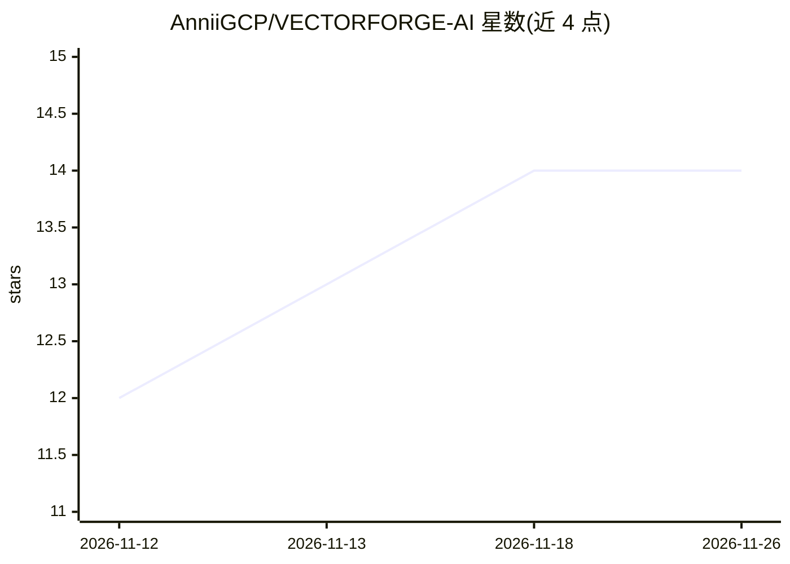

# AnniiGCP/VECTORFORGE-AI

⭐ 14 · Java · MIT · 推送 2026-11-04 · [GitHub](https://github.com/AnniiGCP/VECTORFORGE-AI) · 个人维护

**Java 自研向量数据库与本地 RAG 引擎，带可视化与基准测试**

用 Java 21 + Spring Boot 从零实现的向量数据库与本地 RAG 引擎，配 React 前端并打包为单一可执行 JAR。自实现 HNSW、KD-Tree、Brute Force 三种检索算法与三种距离度量，可对比延迟、访问节点数与召回率；内置 Jacobi 特征求解器实现的 PCA 做 2-D 投影可视化。RAG 流水线通过 Ollama 本地运行 nomic-embed-text 生成 768 维嵌入，llama3.2 生成带来源引用的流式回答，全部计算在本机完成。定位为教学性项目，用于拆解向量检索内部机制。

## 筛选速览

| 维度 | 判定 | 备注 |
|---|---|---|
| AI 角色 | `ai-native` | 本体是模型或模型工具 |
| 许可风险 | `permissive` | MIT |
| 部署形态 | `None` |  |
| 模型依赖 | local-ok | 支持本地模型 |
| 硬件要求 | — | 无带数字的原话,不猜 |
| 安装摩擦 | `medium` | 含编译或系统依赖之一 |
| 成熟度 | — | 结构信号不足 |

## 能力要点

- 从零实现 HNSW / KD-Tree / Brute Force 三种检索算法可同题对比
- 本地 RAG 流水线：滑窗分块、Ollama 嵌入、HNSW 检索、SSE 流式回答
- 自研 PCA（循环 Jacobi 特征求解器）实时 2-D 散点可视化
- 基准测试套件输出 latency、Recall@K、构建时间与遍历节点数

## 适用场景

- 在自己电脑上离线搭建文档问答（RAG）并查看引用来源
- 对比近似检索与精确检索在延迟和召回上的实际差异
- 学习向量索引与高维降维的内部实现原理
- 对自造向量数据集做检索算法基准测试

## 场景标签

`文档问答` `RAG` `向量数据库` · 领域:知识与检索

## 证据(README 行号)

> L17: **VECTORFORGE AI** is an educational, production-grade vector database and Retrieval-Augmented Generation (RAG) eng
> L24: - **Transparent Local RAG:** Instead of piping prompts through distant third-party APIs, VECTORFORGE AI executes en
> L35: - **Local RAG Pipeline:** Multi-stage pipeline with sliding-window chunking, Ollama embedding generation, HNSW retr

## 星数曲线

2026-11-12 12 → 2026-11-26 14（+2）

---
*卡片 v1 · prompt 1.4 · 生成 2026-11-18 · 置信度 high · 依据 README sha `8e84eb0b9ba9` · [字段定义](../../DATASET.md)*
