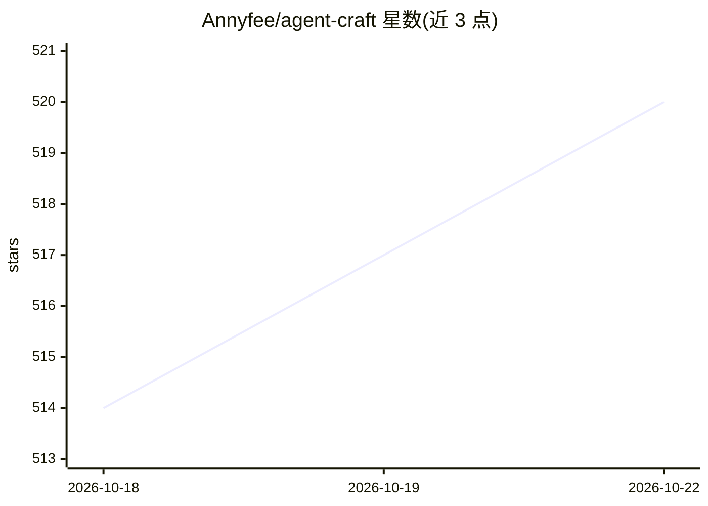

# Annyfee/agent-craft

⭐ 520 · Python · MIT · 推送 2026-10-16 · [GitHub](https://github.com/Annyfee/agent-craft) · [官网](https://blog.csdn.net/2401_87328929/category_13070342.html) · 个人维护 · 中文 README

**AI Agent 教学仓库：从零到部署的 15 模块实战代码与博客**

面向 AI 智能体学习者的系统化教学仓库：以 Python 编写可运行示例，按 15 个模块覆盖 LLM 调用、Function Calling、LangChain、RAG（FAISS/Chroma）、LangGraph 多智能体编排、MCP Server/Client、Agents SDK Swarm 模式、Streamlit 界面与部署上线。每个模块含独立目录的代码与说明，配套 CSDN 博客详解原理，强调本地一键复现。截至 README 当前已开放模块 01–13，模块 14/15 撰写中。需配置 DeepSeek、LangSmith、高德地图、ChatGPT 四个 API Key（config.py 校验非空）。

## 筛选速览

| 维度 | 判定 | 备注 |
|---|---|---|
| AI 角色 | `ai-knowledge` | 知识聚合/清单类 |
| 许可风险 | `permissive` | MIT |
| 部署形态 | `None` |  |
| 模型依赖 | — | README 未给出锁定关系 |
| 硬件要求 | — | 无带数字的原话,不猜 |
| 安装摩擦 | `low` | 无编译、无系统依赖或容器化 |
| 成熟度 | `idea` | |

## 能力要点

- 15 模块渐进式覆盖 Prompt→LLM→LangChain→RAG→LangGraph→MCP→部署全流程
- 每个模块独立目录，代码可运行、本地一键复现
- 涵盖 MCP Server（Stdio/Streamable HTTP）与 MCP Client（langchain-mcp-adapters）实现
- 配套 CSDN 博客详解设计思路与关键机制

## 适用场景

- 系统学习 AI Agent 开发从入门到部署的完整路径
- 动手复现 RAG、多智能体编排、MCP 等典型场景代码
- 跟随博客理解 LangChain/LangGraph 框架内部机制

## 场景标签

`教程课程` · 领域:学习与行业

## 证据(README 行号)

> L3: > ✅ **系统性开源教学项目**，手把手带你用 Python 构建可运行的 AI Agent，涵盖 Prompt、LLM、LangChain、RAG、LangGraph、MCP 到部署发布全流程。
> L25: ## 🧭 模块总览（15 模块）

## 星数曲线

2026-10-18 514 → 2026-10-22 520（+6）

---
*卡片 v1 · prompt 1.4 · 生成 2026-10-21 · 置信度 high · 依据 README sha `debd883853f6` · [字段定义](../../DATASET.md)*
