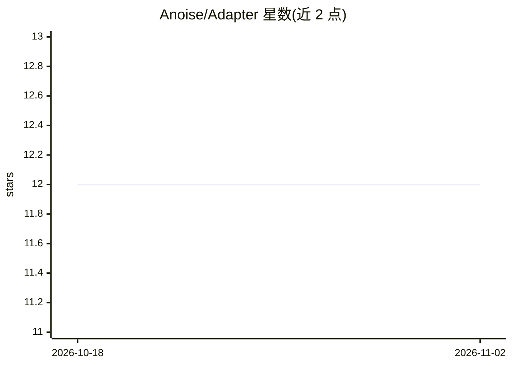

# Anoise/Adapter

⭐ 12 · Jupyter Notebook · 推送 2026-04-14 · [GitHub](https://github.com/Anoise/Adapter) · 个人维护 · 中文 README

**后处理式时间序列预测适配器：冻结原模型即可增强已部署预测器**

ICLR 2026 论文官方代码库。提出 δ-Adapter：一种轻量、架构无关的后处理模块，通过输入端 nudging 与输出端残差校正两种放置方式（加性/乘性）增强已部署的时间序列预测器，无需重训骨干模型。附带可学习预算化掩码做特征选择，以及 Quantile/Conformal 校准器提供带有限样本覆盖保证的不确定性估计。提供数据集下载（Google Drive/清华云）、run.sh 训练与测试脚本，实验覆盖多骨干与多数据集；在 Python 3.10 + CUDA 12.4 环境下训练，PyTorch >= 1.12。

## 筛选速览

| 维度 | 判定 | 备注 |
|---|---|---|
| AI 角色 | `ai-native` | 本体是模型或模型工具 |
| 许可风险 | `none` | — |
| 部署形态 | `None` |  |
| 模型依赖 | — | README 未给出锁定关系 |
| 硬件要求 | — | 无带数字的原话,不猜 |
| 安装摩擦 | `medium` | 含编译或系统依赖之一 |
| 成熟度 | — | 结构信号不足 |

## 能力要点

- 输入/输出两种放置方式的即插即用适配器，骨干模型 F 保持冻结
- 可学习预算化掩码识别并保留关键输入特征
- Quantile 与 Conformal 校准器提供有限样本覆盖保证的不确定性
- 在多骨干与多基准上报告精度与校准的实验结果

## 适用场景

- 我已部署了一个时序预测模型，想在不重训的情况下提升精度
- 为时序预测补充可校准的不确定性区间
- 用掩码适配器做时序输入特征选择

## 场景标签

 · 领域:机器学习/时间序列预测

## 证据(README 行号)

> L3: TL;DR: We propose post-hoc, a lightweight, architecture-agnostic way to boost deployed time series forecasters witho
> L17:  - We formalize $\delta$-Adapter and instantiate two placements (input nudging and output residual correction) in a
> L19:  - We propose quantile and conformal calibrators that deliver calibrated, heteroscedastic uncertainty with finite-s

## 星数曲线

2026-10-18 12 → 2026-11-02 12（+0）

---
*卡片 v1 · prompt 1.4 · 生成 2026-11-01 · 置信度 high · 依据 README sha `49f7a4fe688f` · [字段定义](../../DATASET.md)*
