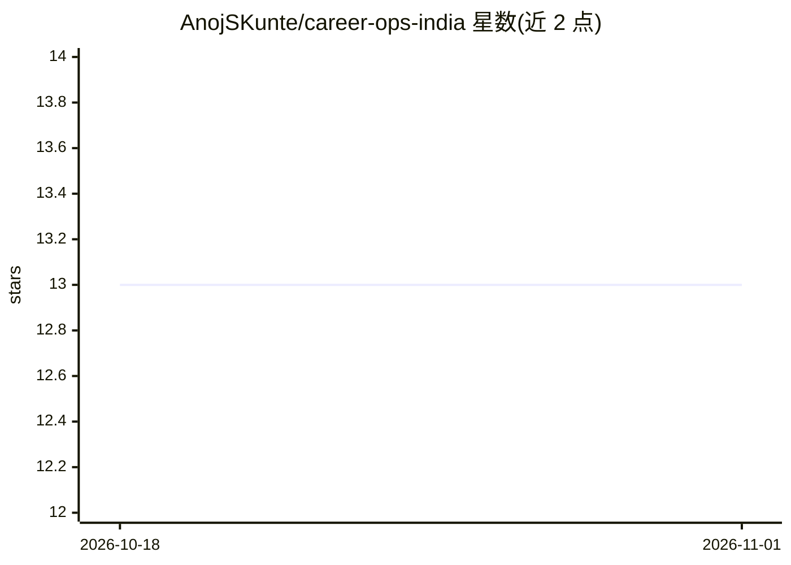

# AnojSKunte/career-ops-india

⭐ 13 · Python · MIT · 推送 2026-05-18 · [GitHub](https://github.com/AnojSKunte/career-ops-india) · 个人维护

**面向印度求职者的 AI 求职流水线：扫描、评估、定制简历**

为印度市场早期职业人群（数据、分析、产品岗位）构建的求职流水线：通过 Greenhouse/Lever/Ashby 的 ATS JSON API 扫描 230 家预配置印度公司（另支持 LinkedIn 公共接口与 Naukri 浏览器模拟），配合 Claude Code 或 Gemini CLI 使用斜杠命令完成职位 A–F 十维度评估、批量排序、按 JD 重写简历生成 PDF、申请追踪、面试准备与薪资谈判脚本。个人数据（CV、配置、报告）全部 gitignore 留在本地。需 Node.js 18+ 与至少一个 AI CLI。

## 筛选速览

| 维度 | 判定 | 备注 |
|---|---|---|
| AI 角色 | `ai-native` | 本体是模型或模型工具 |
| 许可风险 | `permissive` | MIT |
| 部署形态 | `library` | 以包/库形式分发 |
| 模型依赖 | — | README 未给出锁定关系 |
| 硬件要求 | — | 无带数字的原话,不猜 |
| 安装摩擦 | `low` | 无编译、无系统依赖或容器化 |
| 成熟度 | — | 结构信号不足 |

## 能力要点

- 直连 Greenhouse/Lever/Ashby ATS JSON API 扫描，无需爬虫或登录
- 10 维度加权 A–F 职位评估（含幽灵职位检测）
- 斜杠命令在 Claude Code 与 Gemini CLI 中行为一致（/evaluate /pdf /batch 等）
- Naukri 来源需额外安装 Playwright 且其 ToS 禁止爬取，仅供个人求职

## 适用场景

- 扫描印度公司 ATS 获取匹配职位并按契合度排序
- 让 AI 按具体 JD 重写简历要点并生成定制 PDF
- 追踪申请阶段、准备面试与撰写外联/谈判消息

## 场景标签

`网页抓取` `AI 写作` · 领域:效率与自动化

## 证据(README 行号)

> L5: **AI-powered job search pipeline for the Indian market**
> L26: |`/pdf [job]`|Rewrites your resume for a specific job — injects JD keywords, reorders bullets, stays truthful.|
> L53: Open Claude Code or Gemini CLI in this folder. The AI has already read your CV, your target salary, and your skills

## 星数曲线

2026-10-18 13 → 2026-11-01 13（+0）

---
*卡片 v1 · prompt 1.4 · 生成 2026-10-31 · 置信度 high · 依据 README sha `15ab620957d4` · [字段定义](../../DATASET.md)*
