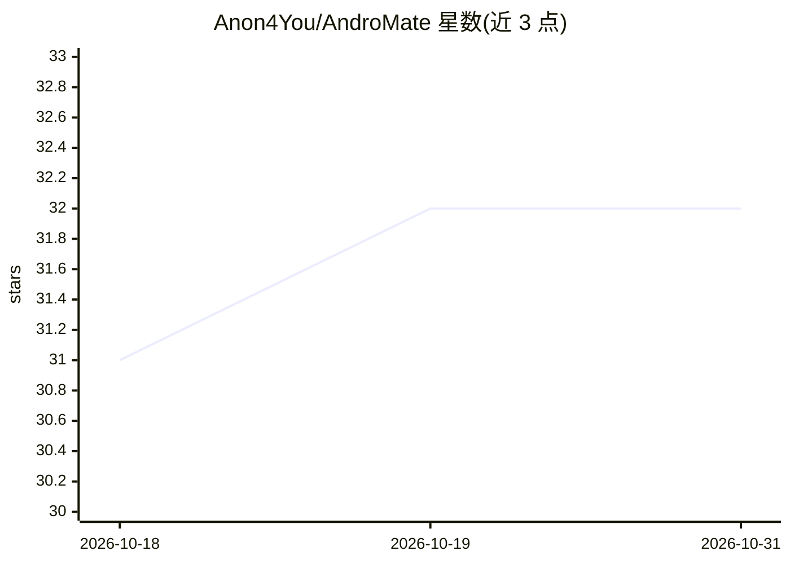

# Anon4You/AndroMate

⭐ 32 · Python · MIT · 推送 2026-06-12 · [GitHub](https://github.com/Anon4You/AndroMate) · 个人维护

**运行在 Termux 上的 Android 语音/聊天 AI 助手，可控制设备**

基于 Python 的 Android（Termux）AI 助手：通过 CLI、语音、Telegram Bot 和 Web 仪表盘交互，接入任意 OpenAI 兼容 API（含 OpenRouter、OpenAI、Ollama、LM Studio、vLLM、Groq、Together 等预设）。设备控制能力覆盖短信、通话、邮件、WhatsApp（wacli）、联系人、拍照、WiFi/亮度/音量等 Termux API 操作；语音识别用 termux-speech-to-text，语音反馈用 termux-tts-speak。需 Android 权限授予，通过 git clone 与 install.sh 安装。

## 筛选速览

| 维度 | 判定 | 备注 |
|---|---|---|
| AI 角色 | `ai-native` | 本体是模型或模型工具 |
| 许可风险 | `permissive` | MIT |
| 部署形态 | `library` | 以包/库形式分发 |
| 模型依赖 | local-ok | 支持本地模型 |
| 硬件要求 | — | 无带数字的原话,不猜 |
| 安装摩擦 | `low` | 无编译、无系统依赖或容器化 |
| 成熟度 | — | 结构信号不足 |

## 能力要点

- 多 AI 提供商接入：任意 OpenAI 兼容 API，内置 9 种预设
- 设备控制：短信/通话/邮件/WhatsApp/相机/WiFi/亮度/音量
- termux-speech-to-text 语音识别与 termux-tts-speak 语音反馈
- Telegram Bot 远程控制与浏览器 Web 仪表盘两种远程入口

## 适用场景

- 在 Android 手机上用自然语言或语音控制短信、通话、拍照等设备功能
- 通过 Telegram 远程操作手机（查电量、定位、执行 shell 命令）
- 在 Termux 中搭配本地 Ollama 使用 AI 助手

## 场景标签

`AI 助手` `语音 Agent` · 领域:对话与助手

## 证据(README 行号)

> L5:  Your AI-powered Android assistant — chat, call, text, control.
> L33: - **Multi-Provider AI** — Use any OpenAI-compatible API: OpenAI, OpenRouter, Ollama, LM Studio, vLLM, Groq, Togethe
> L39: - **Native Voice Recognition** — Hands-free control via `termux-speech-to-text`

## 星数曲线

2026-10-18 31 → 2026-10-31 32（+1）

---
*卡片 v1 · prompt 1.4 · 生成 2026-10-26 · 置信度 mid · 依据 README sha `34ae7db4834d` · [字段定义](../../DATASET.md)*
