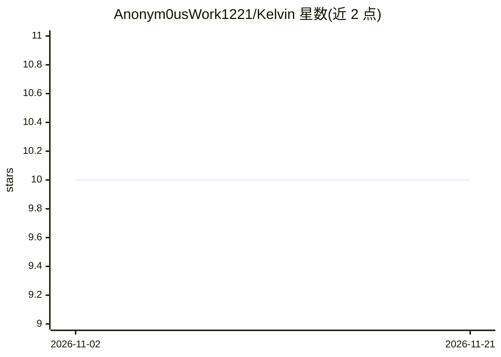

# Anonym0usWork1221/Kelvin

⭐ 10 · Kotlin · MIT · 推送 2026-07-28 · [GitHub](https://github.com/Anonym0usWork1221/Kelvin) · 个人维护

**rooted Android 的热调节守护进程与本地 AI 工作室**

面向已 root 的 Android 设备的模块+应用组合：kelvind 原生 C 守护进程检测前台工作负载（推理进程自动识别、游戏手动指派），按 Game/AI-Sustained/Balanced/Battery 四种曲线调整 cpufreq 与 GPU devfreq，附温度上限、恢复备份与防变砖 watchdog。应用侧提供本地 LLM 聊天（llama.cpp/GGUF）、Stable Diffusion 生图、模型管理与 RAM 管理，全部离线运行。安装方式为 Releases 下载 zip 刷入 Magisk/KernelSU/APatch 并装配套 APK。

## 筛选速览

| 维度 | 判定 | 备注 |
|---|---|---|
| AI 角色 | `ai-native` | 本体是模型或模型工具 |
| 许可风险 | `permissive` | MIT |
| 部署形态 | `desktop` | 安装包/桌面程序 |
| 模型依赖 | local-ok | 支持本地模型 |
| 硬件要求 | — | 无带数字的原话,不猜 |
| 安装摩擦 | `medium` | 含编译或系统依赖之一 |
| 成熟度 | — | 结构信号不足 |

## 能力要点

- AI-Sustained 频率曲线：以 scaling_min 抬升下限维持推理吞吐
- 本地 AI 工作室：llama.cpp 流式聊天、Stable Diffusion 生图、100% 离线
- Hexagon NPU 运行路径（限 Q4_0/Q8_0/MXFP4 量化，8 Gen 2+）
- fork 后经 GitHub Actions 将 HuggingFace safetensors 转为 GGUF

## 适用场景

- 手机上长时间跑本地 LLM 推理不降频
- 给具体游戏指派性能配置文件
- 无云端依赖的本地聊天与生图

## 场景标签

`图像生成` `推理引擎` `聊天机器人` · 领域:对话与助手

## 证据(README 行号)

> L67: Kelvin isn't just a governor — it ships a **fully local, private AI studio** that runs entirely
> L81: - 💬 **Local LLM chat (`llama.cpp` / GGUF).** Real streaming chat with any GGUF model, token by

## 星数曲线

2026-11-02 10 → 2026-11-21 10（+0）

---
*卡片 v1 · prompt 1.4 · 生成 2026-11-20 · 置信度 high · 依据 README sha `22943f5f82ee` · [字段定义](../../DATASET.md)*
