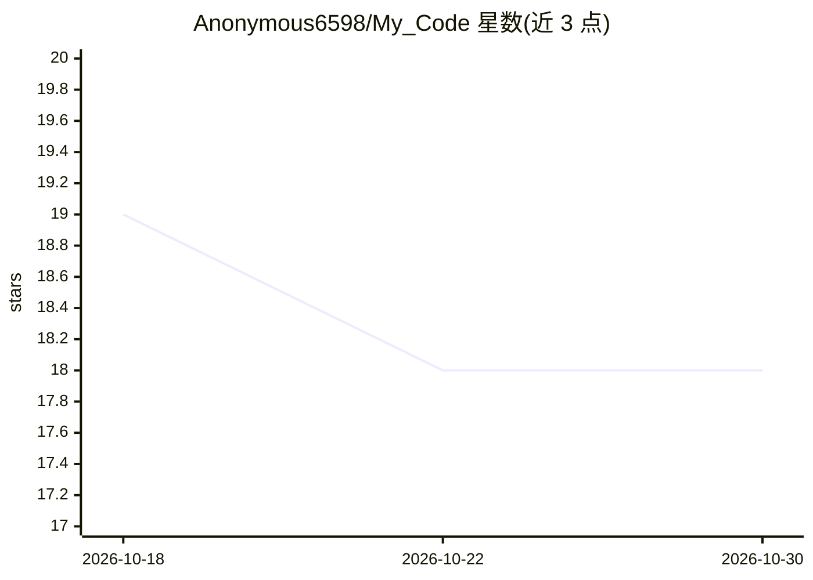

# Anonymous6598/My_Code

⭐ 18 · Python · GPL-3.0 · 推送 2026-03-15 · [GitHub](https://github.com/Anonymous6598/My_Code) · 个人维护

**面向初学者的 Python 代码编辑器，带 AI 助手聊天与脚本运行**

用 CustomTkinter/Tkinter 构建的桌面 Python 代码编辑器，提供脚本运行、快捷键和集成终端。AI 功能包括 GPT-4（Llama 3.2）助手聊天机器人、AI coding（my coder）与 whisper 语音编码（whisper me code）特性，用于辅助写代码与学习编程。支持 Windows 与 Linux，另有 Copilot+PC 版本，该版本仅支持 Intel Core Ultra 处理器，要求 2GB 内存（推荐 4GB），AMD 与 Qualcomm 支持待添加。界面文本为塞尔维亚语。

## 筛选速览

| 维度 | 判定 | 备注 |
|---|---|---|
| AI 角色 | `ai-enhanced` | 去掉 AI 部分产品仍成立 |
| 许可风险 | `viral` | GPL-3.0 |
| 部署形态 | `None` |  |
| 模型依赖 | — | README 未给出锁定关系 |
| 硬件要求 | — | 无带数字的原话,不猜 |
| 安装摩擦 | `low` | 无编译、无系统依赖或容器化 |
| 成熟度 | `idea` | |

## 能力要点

- 脚本运行、快捷键与集成终端
- GPT-4（Llama 3.2）助手聊天机器人
- whisper me code 语音编码特性
- Windows / Linux / Copilot+PC 三个平台截图展示

## 适用场景

- 初学者编写并直接运行 Python 脚本
- 借助 AI 聊天助手学习编程与优化代码
- 在 Copilot+PC 笔记本上使用本地编辑器

## 场景标签

`AI 助手` `聊天机器人` `代码生成` · 领域:编码与开发

## 证据(README 行号)

> L1: # My_Code
> L2: This is new python code editor for begginers with script run ability and with hot keys. And with Open AI GPT-4 (Llam

## 星数曲线

2026-10-18 19 → 2026-10-30 18（-1）

---
*卡片 v1 · prompt 1.4 · 生成 2026-10-29 · 置信度 mid · 依据 README sha `ed68bc04a4ad` · [字段定义](../../DATASET.md)*
