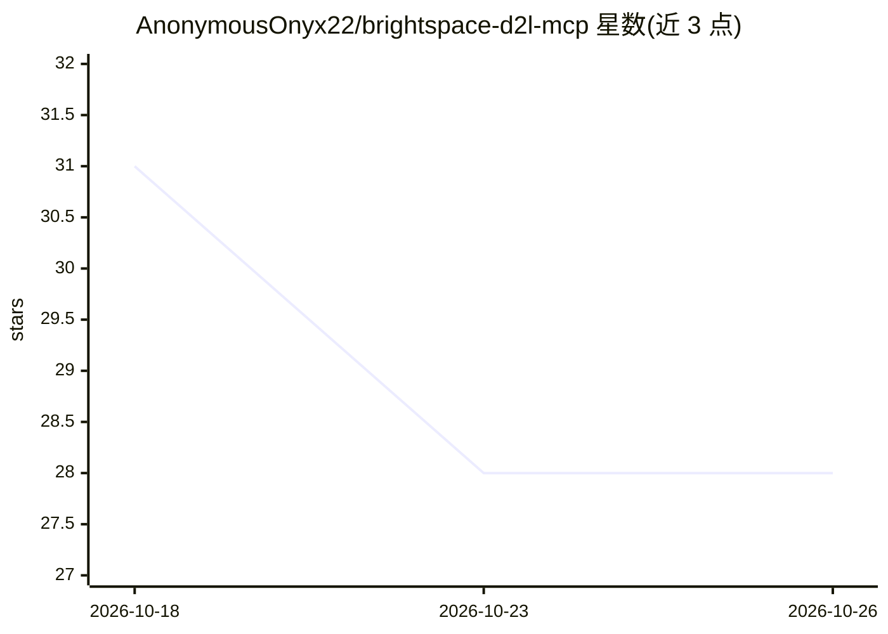

# AnonymousOnyx22/brightspace-d2l-mcp

⭐ 28 · TypeScript · NOASSERTION · 推送 2026-10-24 · [GitHub](https://github.com/AnonymousOnyx22/brightspace-d2l-mcp) · [官网](https://brightspace-mcp.netlify.app) · 个人维护

**让学生通过 AI 助手查询 Brightspace 作业、成绩与课程的 MCP 服务器**

一个 MCP (Model Context Protocol) 服务器，为 Claude、ChatGPT、Cursor、Copilot 等 AI 应用提供对 D2L Brightspace 课程的只读访问：带真实提交状态的截止日期、成绩、作业、评分标准、课程内容、公告、讨论与班级名单，共 17 个工具。通过打开常规浏览器窗口由用户自行登录，支持 Microsoft、Duo、Okta、Shibboleth 等任意 SSO，不存储密码，仅保留浏览器会话。要求 Node.js 20+ 与 Chrome 或 Edge，以 npx 命令安装，通过 stdio 或 streamable HTTP 运行。

## 筛选速览

| 维度 | 判定 | 备注 |
|---|---|---|
| AI 角色 | `ai-ecosystem` | LLM/agent 周边工具 |
| 许可风险 | `none` | NOASSERTION |
| 部署形态 | `library` | 以包/库形式分发 |
| 模型依赖 | locked-api |  |
| 硬件要求 | — | 无带数字的原话,不猜 |
| 安装摩擦 | `low` | 无编译、无系统依赖或容器化 |
| 成熟度 | — | 结构信号不足 |

## 能力要点

- 17 个只读 MCP 工具：待办、成绩展望、日历导出（.ics）、公告讨论等
- 每个截止日期带真实提交状态（submitted/not_submitted/draft 等）
- 常规浏览器窗口登录，兼容任意 SSO（Microsoft/Duo/Okta/Shibboleth），不存密码
- setup 自动发现并连接本机已装的 AI 应用（Claude Desktop、Cursor 等 13 个）

## 适用场景

- 问 AI『我现在该做什么』并获得跳过已交作业的待办清单
- 查询成绩、计算达到目标分数还需在剩余作业拿多少分
- 把未完成截止日期导出到日历、阅读课程资料与公告

## 场景标签

 · 领域:教育技术/LLM 接入工具

## 证据(README 行号)

> L19: An MCP (Model Context Protocol) server that gives AI assistants and agents read access to your Brightspace courses:
> L125: 17 MCP tools for D2L Brightspace. Everything reads from Brightspace and nothing is ever changed there:

## 星数曲线

2026-10-18 31 → 2026-10-26 28（-3）

---
*卡片 v1 · prompt 1.4 · 生成 2026-10-26 · 置信度 high · 依据 README sha `5749dae70341` · [字段定义](../../DATASET.md)*
