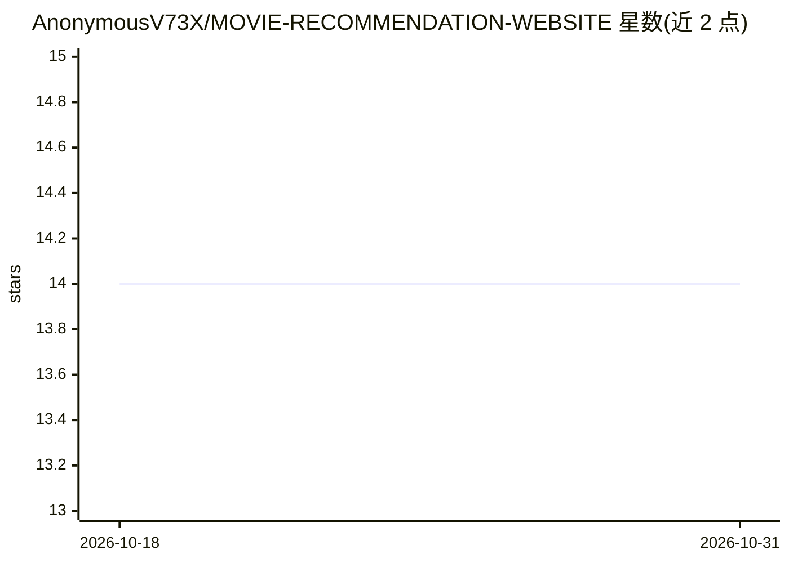

# AnonymousV73X/MOVIE-RECOMMENDATION-WEBSITE

⭐ 14 · HTML · 推送 2026-03-11 · [GitHub](https://github.com/AnonymousV73X/MOVIE-RECOMMENDATION-WEBSITE) · [官网](https://t.me/smartentertainmentt) · 个人维护

**大学课程作业：基于 TF-IDF 与余弦相似度的电影推荐网站**

大学 AI 算法课程作业实现的电影推荐 Web 应用：使用 TF-IDF 向量化与余弦相似度计算电影相似性并给出推荐。工作流程分两步：先在 Colab 中训练并下载 PKL 模型文件（相似度矩阵、电影元数据、标题索引等）放入 models/ 目录，再通过 pip install -r requirements.txt 安装依赖、运行 app.py，在 localhost:5000 访问。README 仅含安装说明，未描述更多功能细节或使用限制。

## 筛选速览

| 维度 | 判定 | 备注 |
|---|---|---|
| AI 角色 | `ai-native` | 本体是模型或模型工具 |
| 许可风险 | `none` | — |
| 部署形态 | `library` | 以包/库形式分发 |
| 模型依赖 | — | README 未给出锁定关系 |
| 硬件要求 | — | 无带数字的原话,不猜 |
| 安装摩擦 | `low` | 无编译、无系统依赖或容器化 |
| 成熟度 | — | 结构信号不足 |

## 能力要点

- TF-IDF 向量化结合余弦相似度计算电影相似性
- 模型在 Colab 训练后以 PKL 文件加载
- Flask 形式本地运行，localhost:5000 访问

## 适用场景

- 学习 TF-IDF 与余弦相似度在推荐系统中的应用
- 作为大学推荐系统课程作业的参考实现

## 场景标签

`推荐系统` `教程课程` · 领域:学习与行业

## 证据(README 行号)

> L1: # CineMatch v2 — Movie Recommender Web App
> L18: pip install -r requirements.txt

## 星数曲线

2026-10-18 14 → 2026-10-31 14（+0）

---
*卡片 v1 · prompt 1.4 · 生成 2026-10-31 · 置信度 high · 依据 README sha `94b6b4122e9c` · [字段定义](../../DATASET.md)*
