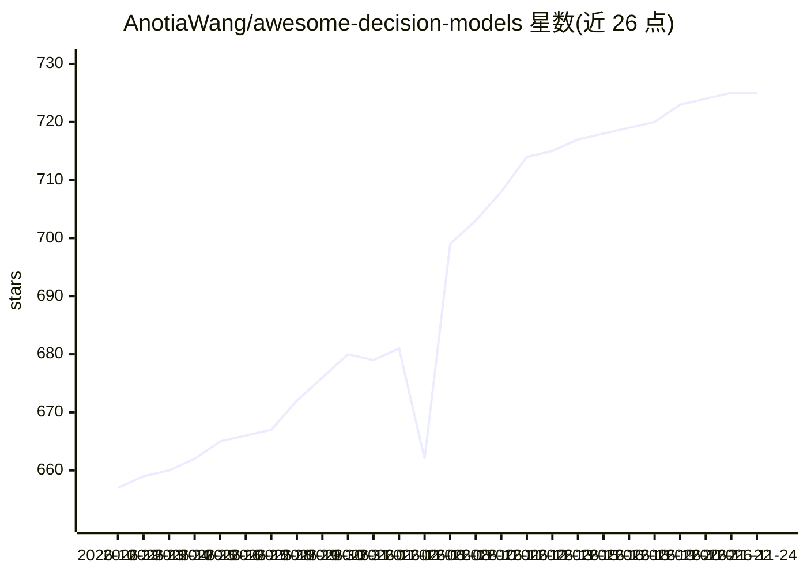

# AnotiaWang/awesome-decision-models

⭐ 725 · Python · CC0-1.0 · 推送 2026-11-13 · [GitHub](https://github.com/AnotiaWang/awesome-decision-models) · [官网](https://anotiawang.github.io/awesome-decision-models/) · 个人维护

**决策模型资源的社区策展清单**

社区维护的决策模型清单，收录托管 API、开放权重模型、运行时、SDK、应用、基准与论文。决策模型读取状态与预声明问题（Noul/Choice/Score 三种形态），返回每个答案的概率而非生成文本。条目按托管 API 与开放模型分类，标注兼容 `/v1/systemone` 请求格式的模型与服务器。声明不隶属于任何模型提供商，接受 Pull Request。

## 筛选速览

| 维度 | 判定 | 备注 |
|---|---|---|
| AI 角色 | `ai-knowledge` | 知识聚合/清单类 |
| 许可风险 | `viral` | CC0-1.0 |
| 部署形态 | `library` | 以包/库形式分发 |
| 模型依赖 | — | README 未给出锁定关系 |
| 硬件要求 | — | 无带数字的原话,不猜 |
| 安装摩擦 | `medium` | 含编译或系统依赖之一 |
| 成熟度 | — | 结构信号不足 |

## 能力要点

- 按托管 API 与开放权重模型两类组织条目
- 标注各模型对 `/v1/systemone` 请求格式的兼容情况
- 开放模型条目附各自基准分数（声明跨条目不可比）

## 适用场景

- 查找兼容同一请求格式的决策模型
- 了解可下载运行的开放权重决策模型清单
- 调研决策模型的托管 API 与基准

## 场景标签

`精选清单` · 领域:学习与行业

## 证据(README 行号)

> L3: A curated list of decision models (also called System One models or typed decision models) and the APIs, runtimes, t
> L9: Community-maintained and not affiliated with any model provider. Pull requests welcome.

## 星数曲线

2026-10-22 657 → 2026-11-24 725（+68）

---
*卡片 v1 · prompt 1.4 · 生成 2026-11-24 · 置信度 mid · 依据 README sha `881ff699b50e` · [字段定义](../../DATASET.md)*
