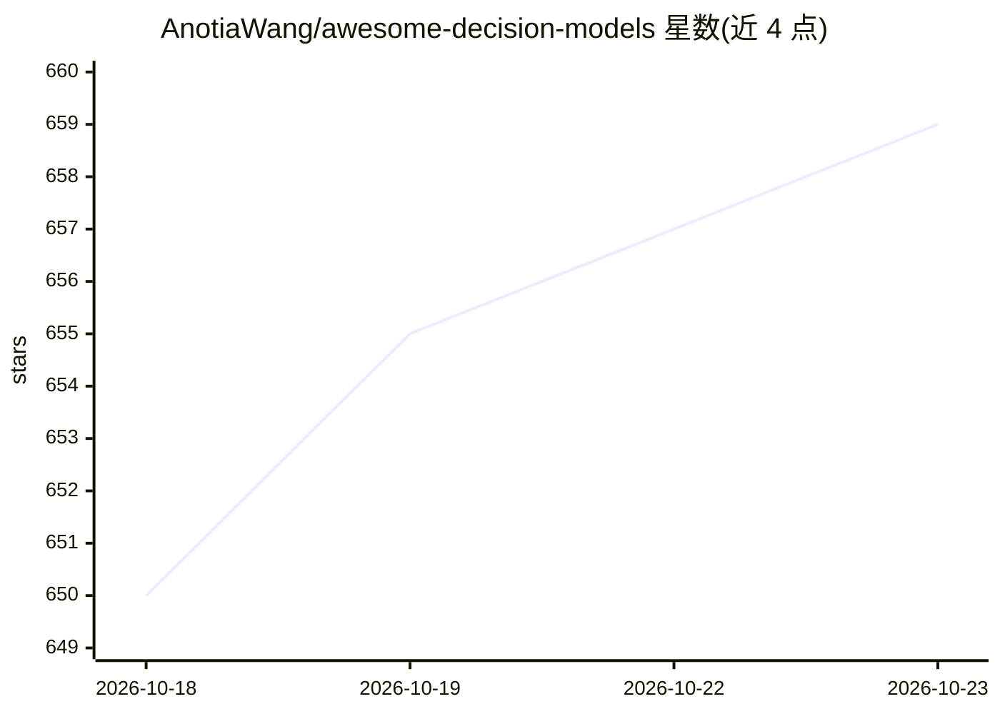

# AnotiaWang/awesome-decision-models

⭐ 659 · Python · CC0-1.0 · 推送 2026-10-22 · [GitHub](https://github.com/AnotiaWang/awesome-decision-models) · [官网](https://anotiawang.github.io/awesome-decision-models/) · 个人维护 · 中文 README

**决策模型（System One）生态策展清单：API、模型、运行时与论文**

社区维护的 decision model（System One / typed decision models）聚合清单：收录托管 API、开源权重模型、运行时、SDK、应用、基准与论文。决策模型读取状态（文本/JSON/图像）与预先声明的问题，返回每个选项的概率而非生成文本，问题分 Noul、Choice、Score 三类，多采用 TypeSafe AI 提出的 /v1/systemone 请求格式。清单声明与任何模型提供商无隶属，接受 PR。面向在该领域选型的开发者与研究者。

## 筛选速览

| 维度 | 判定 | 备注 |
|---|---|---|
| AI 角色 | `ai-knowledge` | 知识聚合/清单类 |
| 许可风险 | `viral` | CC0-1.0 |
| 部署形态 | `library` | 以包/库形式分发 |
| 模型依赖 | — | README 未给出锁定关系 |
| 硬件要求 | — | 无带数字的原话,不猜 |
| 安装摩擦 | `medium` | 含编译或系统依赖之一 |
| 成熟度 | — | 结构信号不足 |

## 能力要点

- 收录托管 API 与开源权重决策模型（0.8B–35B 多规格）
- 条目围绕 Noul/Choice/Score 三类问题与 /v1/systemone 请求格式组织
- 覆盖公司/实验室与社区模型、基准与应用生态
- 中英双语 README

## 适用场景

- 为项目挑选可调用的决策模型 API 或开源权重
- 了解决策模型生态的运行时、SDK 与基准覆盖
- 对比各模型报告的 Decision Index 等评测分数来源

## 场景标签

`精选清单` · 领域:学习与行业

## 证据(README 行号)

> L3: A curated list of decision models (also called System One models or typed decision models) and the APIs, runtimes, t
> L7: A decision model reads a state (text, JSON, and for some models images) plus questions whose answers you declare up 
> L11: ## Contents

## 星数曲线

2026-10-18 650 → 2026-10-23 659（+9）

---
*卡片 v1 · prompt 1.4 · 生成 2026-10-21 · 置信度 mid · 依据 README sha `b98c4f2983a2` · [字段定义](../../DATASET.md)*
