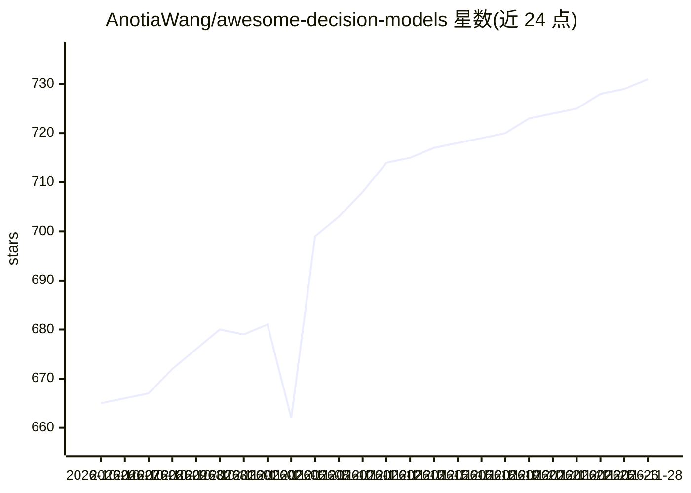

# AnotiaWang/awesome-decision-models

⭐ 731 · Python · CC0-1.0 · 推送 2026-11-27 · [GitHub](https://github.com/AnotiaWang/awesome-decision-models) · [官网](https://anotiawang.github.io/awesome-decision-models/) · 个人维护

**决策模型（System One）资源清单：API、开源权重、运行时与论文**

社区维护的决策模型（System One / typed decision models）策展清单，声明不隶属于任何模型提供商。定义了决策模型的统一请求形态：读取文本/JSON/图像状态与预声明问题（Noul/Choice/Score 三种），为每个选项返回概率而非生成文本。条目按托管 API、开源权重模型（公司实验室与社区两部分）分类组织，涵盖 Jev 等多个模型及基准、论文链接，提供英文与简体中文双语页面。

## 筛选速览

| 维度 | 判定 | 备注 |
|---|---|---|
| AI 角色 | `ai-knowledge` | 知识聚合/清单类 |
| 许可风险 | `viral` | CC0-1.0 |
| 部署形态 | `library` | 以包/库形式分发 |
| 模型依赖 | — | README 未给出锁定关系 |
| 硬件要求 | — | 无带数字的原话,不猜 |
| 安装摩擦 | `medium` | 含编译或系统依赖之一 |
| 成熟度 | — | 结构信号不足 |

## 能力要点

- 按托管 API 与开源权重模型分类的策展清单
- 定义 Noul/Choice/Score 三类问题的统一请求形态 /v1/systemone
- 收录公司模型与社区模型两大板块及对应基准分数
- 提供英文/简体中文双语与网站入口

## 适用场景

- 为 agent 的工具调用或路由环节选型决策模型
- 查找可本地下载运行的开源决策模型权重
- 调研 System One 模型类别的生态与基准

## 场景标签

`精选清单` · 领域:学习与行业

## 证据(README 行号)

> L3: A curated list of decision models (also called System One models or typed decision models) and the APIs, runtimes, t
> L9: Community-maintained and not affiliated with any model provider. Pull requests welcome.

## 星数曲线

2026-10-26 665 → 2026-11-28 731（+66）

---
*卡片 v1 · prompt 1.4 · 生成 2026-11-28 · 置信度 mid · 依据 README sha `318a8fa18bc5` · [字段定义](../../DATASET.md)*
