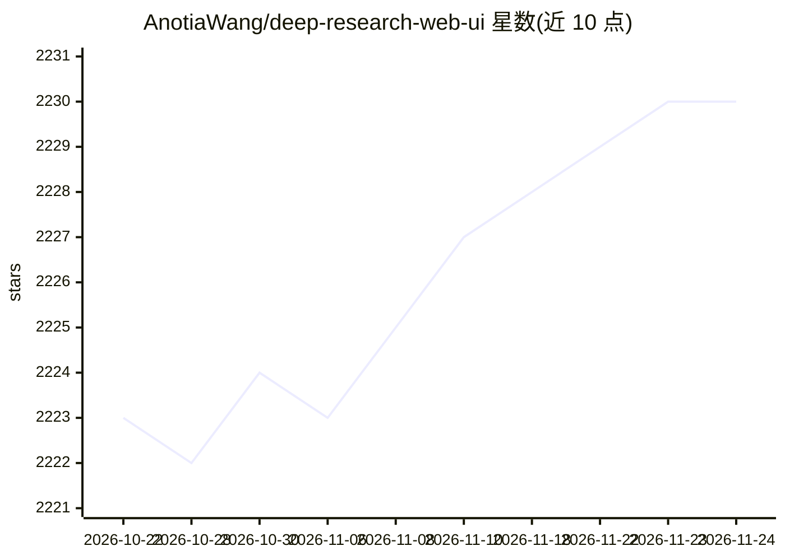

# AnotiaWang/deep-research-web-ui

⭐ 2,230 · TypeScript · 推送 2026-11-15 · [GitHub](https://github.com/AnotiaWang/deep-research-web-ui) · [官网](https://deep-research.ataw.top) · 个人维护

**自托管研究 Agent：把问题变成带引用的报告**

基于 Nuxt 的 Web 应用，将研究问题转化为带引用的报告：规划搜索、抓取网页、按来源页面核验证据，并支持逐条引用追溯与后续追问更新报告。提供 Client Mode（浏览器本地保存 API key）与 Server Mode（服务端环境变量）两种部署方式，支持 Docker 一行命令部署，搜索过程以树状结构可视化，报告可导出 Markdown/PDF。历史记录存于浏览器，需自行导出保留。

## 筛选速览

| 维度 | 判定 | 备注 |
|---|---|---|
| AI 角色 | `ai-native` | 本体是模型或模型工具 |
| 许可风险 | `none` | — |
| 部署形态 | `self-host` | docker 或自建部署 |
| 模型依赖 | local-ok | 支持本地模型 |
| 硬件要求 | — | 无带数字的原话,不猜 |
| 安装摩擦 | `low` | 无编译、无系统依赖或容器化 |
| 成熟度 | — | 结构信号不足 |

## 能力要点

- 引用可逐条查看来源摘录、检索时间，并支持追问后局部更新报告
- Client Mode 下配置与 API 请求留在浏览器本地，Server Mode 走服务端密钥
- 证据不足时自动改写查询重试一次，并按 token/请求预算按需读取整页
- 支持 Docker 部署、EdgeOne Pages / Railway 一键部署与源码自建镜像

## 适用场景

- 把一个研究问题变成带引用的调研报告
- 核验报告中每条结论对应的原始网页摘录
- 自托管一个用自己 API key 的深度研究工具
- 需要导出 Markdown/PDF 报告留档的场景

## 场景标签

`科研工具` · 领域:学习与行业

## 证据(README 行号)

> L5: Deep Research Web UI turns a research question into a cited report: it plans searches, browses the web, verifies fin
> L16: - 🔎 **Evidence and follow-ups**: Inspect source excerpts from report citations, then research a finding further and

## 星数曲线

2026-10-22 2,223 → 2026-11-24 2,230（+7）

---
*卡片 v1 · prompt 1.4 · 生成 2026-11-23 · 置信度 mid · 依据 README sha `c7985fcd9293` · [字段定义](../../DATASET.md)*
