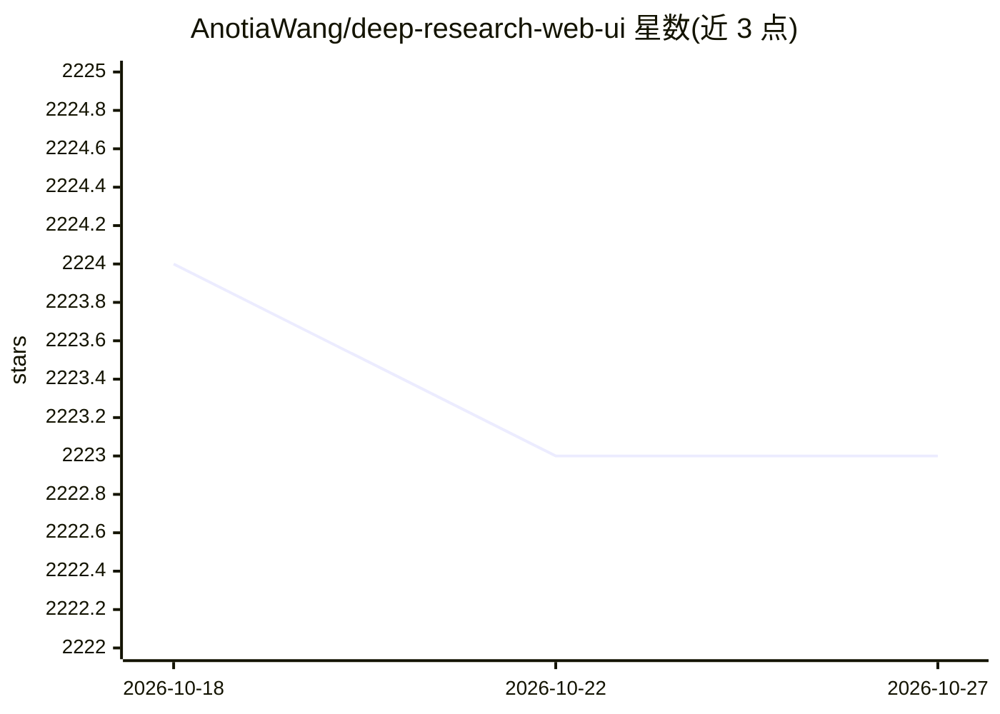

# AnotiaWang/deep-research-web-ui

⭐ 2,223 · TypeScript · 推送 2026-10-26 · [GitHub](https://github.com/AnotiaWang/deep-research-web-ui) · [官网](https://deep-research.ataw.top) · 个人维护 · 中文 README

**把研究问题转为带引用报告的自托管 deep-research Web 应用**

基于 Nuxt 的自托管 Web 应用：接收研究问题后规划搜索、浏览网页、抓取全文验证证据，生成带编号引用的研究报告，可导出 Markdown/PDF；用户可点击引用查看来源摘录并发起追问，追问结果保存为新历史条目而不改动原报告。AI 支持多种 provider（OpenAI 兼容、DeepSeek、OpenRouter、Ollama、LiteLLM 等），搜索支持 Tavily、Firecrawl、Google PSE 等。提供 Client Mode（浏览器本地保存 API key）与 Server Mode（环境变量配置）两种部署方式，Docker 一行命令部署。

## 筛选速览

| 维度 | 判定 | 备注 |
|---|---|---|
| AI 角色 | `ai-native` | 本体是模型或模型工具 |
| 许可风险 | `none` | — |
| 部署形态 | `self-host` | docker 或自建部署 |
| 模型依赖 | local-ok | 支持本地模型 |
| 硬件要求 | — | 无带数字的原话,不猜 |
| 安装摩擦 | `low` | 无编译、无系统依赖或容器化 |
| 成熟度 | — | 结构信号不足 |

## 能力要点

- 引用可检查：报告引用可查看来源摘录、检索时间并追问更新
- 搜索过程以树结构可视化，支持多语言搜索
- 证据不足时改写查询重试，并按需抓取全文提取逐字证据
- Client/Server 双模式，Client Mode 下配置与 API 请求留在浏览器本地

## 适用场景

- 把一个研究问题变成带可核查引用的研究报告
- 自托管部署并用自有 API key 运行研究，不在第三方留存配置
- 对报告中的某个发现继续追问并更新相关段落

## 场景标签

`科研工具` · 领域:学习与行业

## 证据(README 行号)

> L5: Deep Research Web UI turns a research question into a cited report: it plans searches, browses the web, verifies fin
> L22: - AI: OpenAI compatible, ApiSmart, SiliconFlow, DeepSeek, OpenRouter, Requesty, Ollama, LiteLLM and more

## 星数曲线

2026-10-18 2,224 → 2026-10-27 2,223（-1）

---
*卡片 v1 · prompt 1.4 · 生成 2026-10-21 · 置信度 mid · 依据 README sha `beeba31bab3e` · [字段定义](../../DATASET.md)*
