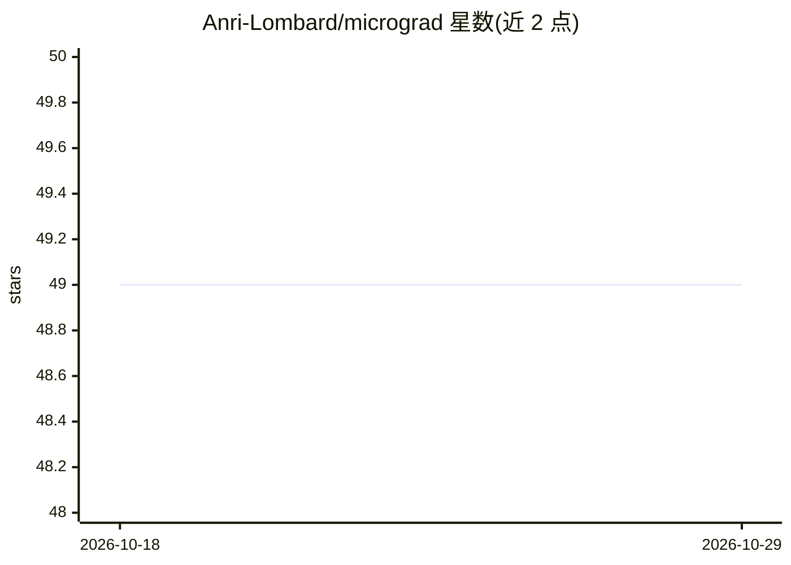

# Anri-Lombard/micrograd

⭐ 49 · Jupyter Notebook · MIT · 推送 2026-10-04 · [GitHub](https://github.com/Anri-Lombard/micrograd) · 个人维护

**跟随 Karpathy micrograd 课程的学习笔记与代码实现**

作者跟随 Andrej Karpathy "Neural Networks: Zero to Hero" 系列第一讲完成的学习仓库：包含带注释的标量自动微分引擎（Value 类，支持 + - * / **、ReLU 与基于拓扑排序的 backward()）、Neuron/Layer/MLP 神经网络库、对照有限差分的梯度检查测试，以及两个课程 notebook。README 主体是讲解反向传播、链式法则、梯度下降等原理的课程笔记和学习方法建议。库本身为纯 Python 3 无依赖；notebook 需 Jupyter/NumPy/Matplotlib/graphviz/PyTorch。

## 筛选速览

| 维度 | 判定 | 备注 |
|---|---|---|
| AI 角色 | `ai-knowledge` | 知识聚合/清单类 |
| 许可风险 | `permissive` | MIT |
| 部署形态 | `library` | 以包/库形式分发 |
| 模型依赖 | — | README 未给出锁定关系 |
| 硬件要求 | — | 无带数字的原话,不猜 |
| 安装摩擦 | `low` | 无编译、无系统依赖或容器化 |
| 成熟度 | — | 结构信号不足 |

## 能力要点

- 标量自动微分引擎（Value 类）与 Neuron/Layer/MLP 实现
- test_engine.py 用有限差分对照验证反向传播
- 两个课程 notebook（含 PyTorch 对照与 MLP 训练）
- 库为纯 Python 3、无依赖

## 适用场景

- 跟随 Karpathy 课程学习自动微分与反向传播原理
- 阅读带注释的 micrograd 实现理解神经网络训练流程
- 用梯度检查验证自己实现的 backward()

## 场景标签

`教程课程` · 领域:学习与行业

## 证据(README 行号)

> L3: My study notes and code from working through Andrej Karpathy's micrograd lecture, the first video in his Neural Netw
> L12: |`Lectures/micrograd_lecture_first_half_roughly.ipynb`|Lecture notebook, part 1: derivatives, building `Value`, gra

## 星数曲线

2026-10-18 49 → 2026-10-29 49（+0）

---
*卡片 v1 · prompt 1.4 · 生成 2026-10-25 · 置信度 mid · 依据 README sha `e9d2d787f217` · [字段定义](../../DATASET.md)*
