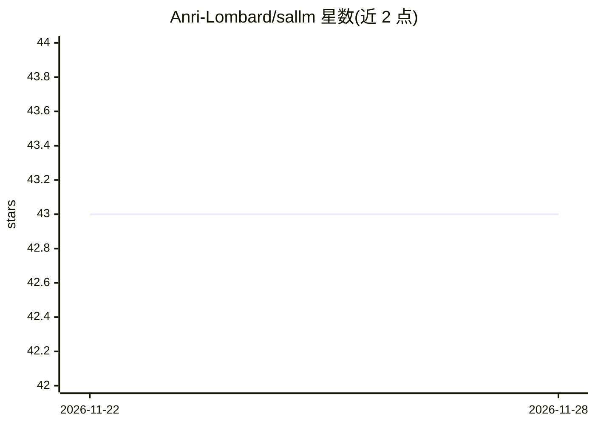

# Anri-Lombard/sallm

⭐ 43 · Python · Apache-2.0 · 推送 2026-11-24 · [GitHub](https://github.com/Anri-Lombard/sallm) · 个人维护

**面向南非11种官方语言的LLM训练与评测框架**

配套 LREC 2026 论文 MzansiText/MzansiLM 的开源仓库，提供预训练、全参数微调与下游评测流程。核心机制：在同一语料上以相同 token 流训练五种约125M decoder 架构（Transformer/Mamba-2/xLSTM/GDN/混合型），用 bits-per-byte 做分语言验证；基于 uv 管理环境，Hydra 管理配置，支持 SLURM 集群启动脚本；语料清洗、去重与 BPE tokenizer 训练脚本包含在仓库内，通过 tag 与冻结分支复现论文结果。

## 筛选速览

| 维度 | 判定 | 备注 |
|---|---|---|
| AI 角色 | `ai-ecosystem` | LLM/agent 周边工具 |
| 许可风险 | `permissive` | Apache-2.0 |
| 部署形态 | `None` |  |
| 模型依赖 | — | README 未给出锁定关系 |
| 硬件要求 | — | 无带数字的原话,不猜 |
| 安装摩擦 | `low` | 无编译、无系统依赖或容器化 |
| 成熟度 | — | 结构信号不足 |

## 能力要点

- 五种 decoder 架构在同一语料上的等预算预训练
- 可组合配置的架构×数据集微调与命名 recipe
- lm-eval task packs 与生成式评测流程
- SLURM 启动脚本与论文复现 tag/分支

## 适用场景

- 为南非语言训练和复现预训练语言模型
- 在相同条件下比较多种 decoder 架构表现
- 对南非语言下游任务做分类与生成评测

## 场景标签

`模型训练` `微调` `模型评测` · 领域:评测与运维

## 证据(README 行号)

> L3: **An open corpus, pretrained language models, and training/evaluation framework for all eleven official South Africa
> L9: This repository accompanies **"MzansiText and MzansiLM: An Open Corpus and Decoder-Only Language Model for South Afr
> L33: Matched multi-architecture pretraining runs through `sallm.pretrain` with identical packed `uint16` token streams (

## 星数曲线

2026-11-22 43 → 2026-11-28 43（+0）

---
*卡片 v1 · prompt 1.4 · 生成 2026-11-22 · 置信度 high · 依据 README sha `c5b23f93c71d` · [字段定义](../../DATASET.md)*
