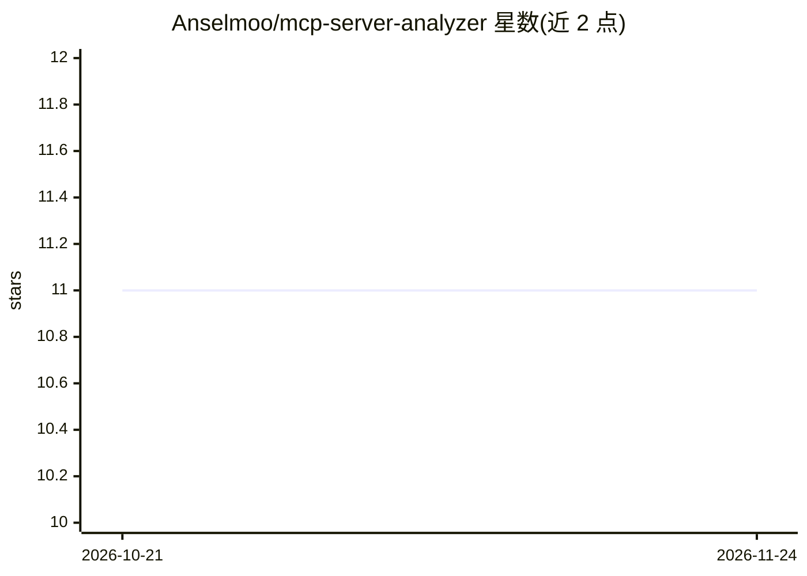

# Anselmoo/mcp-server-analyzer

⭐ 11 · Python · MIT · 推送 2026-08-30 · [GitHub](https://github.com/Anselmoo/mcp-server-analyzer) · [官网](https://anselmoo.github.io/mcp-server-analyzer/) · 个人维护

**面向 AI 助手的 Python 代码分析 MCP 服务器**

基于 Model Context Protocol 的代码分析服务器，封装 Ruff（lint 与格式化）、ty（类型检查）、Vulture（死代码检测）和 Biome（JS/TS 分析），提供 9 个工具并以 0-100 质量分汇总结果。通过 uvx 或 Docker 安装，给出 VS Code、Claude Desktop、Zed、Claude Code 的配置方式。代码仅写入临时文件、分析后即删，无网络外呼与遥测，发布物经 Sigstore/Cosign 签名。要求 Python 3.13+；JS/TS 分析需 Node.js 22+。

## 筛选速览

| 维度 | 判定 | 备注 |
|---|---|---|
| AI 角色 | `ai-ecosystem` | LLM/agent 周边工具 |
| 许可风险 | `permissive` | MIT |
| 部署形态 | `library` | 以包/库形式分发 |
| 模型依赖 | — | README 未给出锁定关系 |
| 硬件要求 | — | 无带数字的原话,不猜 |
| 安装摩擦 | `low` | 无编译、无系统依赖或容器化 |
| 成熟度 | — | 结构信号不足 |

## 能力要点

- 9 个 MCP 工具：ruff-check/format、ty-check、vulture-scan、biome-check/format、综合 analyze-code 等
- 加权质量评分（0-100）合并 Ruff、ty、Vulture 结果
- 内存内处理：临时文件分析后即删，无网络调用、无遥测
- 发布物经 Sigstore/Cosign 签名，SLSA Build Level 3

## 适用场景

- 在 IDE 或 AI 编码助手中接入 Python 代码质量检查
- 在 CI/CD 流程中获取优化的 lint 输出
- 检测 Python 项目中未使用的导入、函数与变量

## 场景标签

`代码审查` · 领域:编码与开发

## 证据(README 行号)

> L14: A powerful Model Context Protocol (MCP) server that provides comprehensive Python code analysis using **Ruff** for 
> L66: - **🚀 FastMCP Framework**: High-performance MCP server implementation
> L80: ## 🛠️ Available Tools

## 星数曲线

2026-10-21 11 → 2026-11-24 11（+0）

---
*卡片 v1 · prompt 1.4 · 生成 2026-11-19 · 置信度 high · 依据 README sha `8111849e830a` · [字段定义](../../DATASET.md)*
