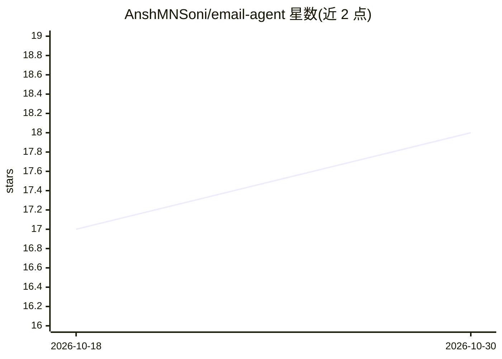

# AnshMNSoni/email-agent

⭐ 18 · Python · MIT · 推送 2026-09-09 · [GitHub](https://github.com/AnshMNSoni/email-agent) · 个人维护

**本地 LLM 驱动的 Gmail 终端助手：自然语言管理收件箱**

基于 LangGraph 状态机编排、Ollama 本地运行 qwen2.5-coder:3b、通过官方 Gmail API 操作的命令行邮件代理。用户以自然语言完成搜索、阅读、摘要、归档、加星、下载/发送附件（解析 PDF/CSV/TXT）、撰写发送与批量删除垃圾邮件，发送前会请求确认。LLM 推理全程本地完成，邮件内容不发送给第三方 AI 提供商。需 Python 3.10+、本机 Ollama 及 GCP 项目的 Gmail API OAuth 凭据，克隆源码安装后 python main.py 运行。

## 筛选速览

| 维度 | 判定 | 备注 |
|---|---|---|
| AI 角色 | `ai-native` | 本体是模型或模型工具 |
| 许可风险 | `permissive` | MIT |
| 部署形态 | `None` |  |
| 模型依赖 | local-ok | 支持本地模型 |
| 硬件要求 | — | 无带数字的原话,不猜 |
| 安装摩擦 | `low` | 无编译、无系统依赖或容器化 |
| 成熟度 | — | 结构信号不足 |

## 能力要点

- 自然语言转 Gmail 查询，覆盖搜索/摘要/标签/删除/发信
- 本地 Ollama 运行 qwen2.5-coder:3b，邮件内容不外发第三方 AI
- 附件文本解析（PDF/CSV/TXT）纳入摘要上下文，支持本地文件发送
- 发送前逐次请求用户确认，credentials/token 默认加入 .gitignore

## 适用场景

- 在终端用对话指令整理和检索 Gmail 收件箱
- 让本地模型摘要邮件及附件而不上传内容
- 用自然语言批量清理垃圾邮件并发送带附件的邮件

## 场景标签

 · 领域:个人效率/邮件自动化

## 证据(README 行号)

> L3: A completely local-first, conversational AI email assistant built with **LangGraph**, **Ollama**, and the **Gmail AP
> L5: This agent runs directly from your terminal and allows you to manage your Gmail inbox using natural language. Becaus
> L23: - **LLM Engine:** `Ollama` running `qwen2.5-coder:3b` locally.

## 星数曲线

2026-10-18 17 → 2026-10-30 18（+1）

---
*卡片 v1 · prompt 1.4 · 生成 2026-10-30 · 置信度 high · 依据 README sha `5631efb23914` · [字段定义](../../DATASET.md)*
