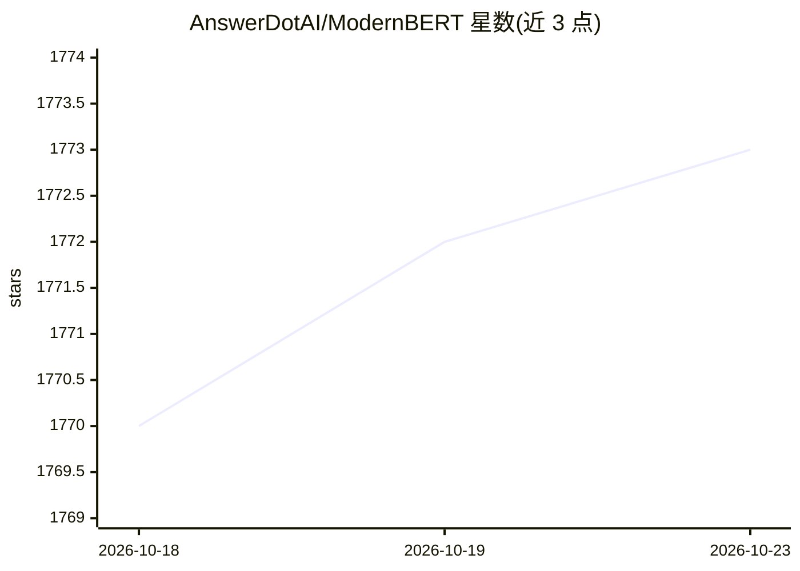

# AnswerDotAI/ModernBERT

⭐ 1,773 · Python · Apache-2.0 · 推送 2026-03-01 · [GitHub](https://github.com/AnswerDotAI/ModernBERT) · [官网](https://arxiv.org/abs/2412.13663) · 组织维护

**ModernBERT 预训练与评测的研究代码库**

Answer.AI 等团队的 ModernBERT 研究仓库：通过 FlexBERT 模块化编码器构建块与 YAML 配置文件构建模型，基于 MosaicBERT 代码（Apache 2.0）扩展。面向预训练与 GLUE 评测，训练依赖 composer 框架与 GPU 环境，通过 conda 环境文件安装；数据支持 MDS/CSV/JSONL 的流式与非流式两种数据集类。另提供基于 Sentence Transformers 与 PyLate 的稠密检索/ColBERT 训练评测脚本。README 自述尚不完整。面向需要复现或继续预训练/微调编码器的研究者。

## 筛选速览

| 维度 | 判定 | 备注 |
|---|---|---|
| AI 角色 | `ai-native` | 本体是模型或模型工具 |
| 许可风险 | `permissive` | Apache-2.0 |
| 部署形态 | `None` |  |
| 模型依赖 | — | README 未给出锁定关系 |
| 硬件要求 | — | 无带数字的原话,不猜 |
| 安装摩擦 | `low` | 无编译、无系统依赖或容器化 |
| 成熟度 | `idea` | |

## 能力要点

- FlexBERT 模块化编码器构建块，YAML 配置驱动建模
- 覆盖预训练与 GLUE 评测，训练代码即实验所用代码
- 检索模型训练/评测脚本（Sentence Transformers 稠密检索与 PyLate ColBERT）
- 流式与非流式两种文本数据集类（MDS/CSV/JSONL）

## 适用场景

- 复现或扩展 ModernBERT 预训练实验
- 微调并评测 GLUE 与检索任务模型
- 基于该代码库训练自己的 ColBERT 或稠密检索模型

## 场景标签

`模型训练` `微调` `模型评测` · 领域:评测与运维

## 证据(README 行号)

> L3: This is the repository where you can find ModernBERT, our experiments to bring BERT into modernity via both architec
> L11: All code used in this repository is the code used as part of our experiments for both pre-training and GLUE evaluat
> L30: Training heavily leverages the composer framework. All training are configured via YAML files, of which you can fin

## 星数曲线

2026-10-18 1,770 → 2026-10-23 1,773（+3）

---
*卡片 v1 · prompt 1.4 · 生成 2026-10-21 · 置信度 high · 依据 README sha `a51b7c7eafda` · [字段定义](../../DATASET.md)*
