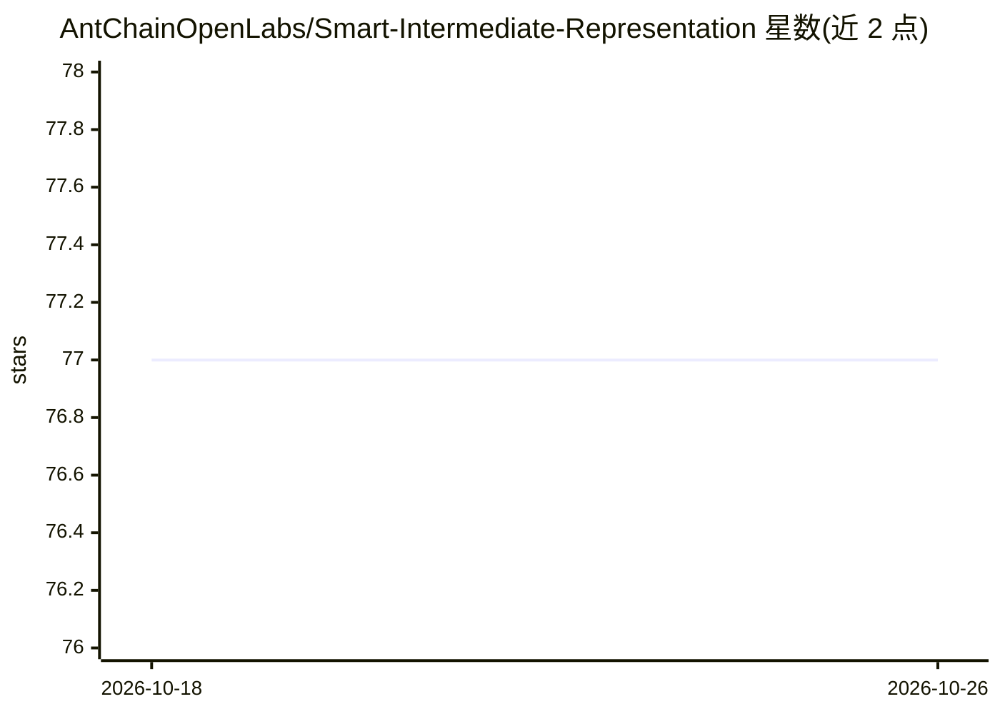

# AntChainOpenLabs/Smart-Intermediate-Representation

⭐ 77 · Rust · Apache-2.0 · 推送 2025-12-21 · [GitHub](https://github.com/AntChainOpenLabs/Smart-Intermediate-Representation) · 组织维护 · 中文 README

**面向智能合约开发的多场景编译器框架，目标 AI 友好与高安全**

受 LLVM、MLIR 与 Solidity/Yul 启发的智能合约编译器框架，提供名为 IR 的中间表示与文本格式（.ir），目标是让智能合约更安全、高性能、Rollup 与 AI 友好并降低 Gas 成本。宣称可适配任意编程语言，帮助区块链平台与开发者获得多场景兼容性。安装需查阅 Development Guide 自行构建，另提供 Docker 镜像用于构建测试 IR 程序。项目处于早期开发阶段，路线图功能多数标注 In progress 或 Not started。

## 筛选速览

| 维度 | 判定 | 备注 |
|---|---|---|
| AI 角色 | `ai-ecosystem` | LLM/agent 周边工具 |
| 许可风险 | `permissive` | Apache-2.0 |
| 部署形态 | `self-host` | docker 或自建部署 |
| 模型依赖 | — | README 未给出锁定关系 |
| 硬件要求 | — | 无带数字的原话,不猜 |
| 安装摩擦 | `low` | 无编译、无系统依赖或容器化 |
| 成熟度 | `idea` | |

## 能力要点

- 提供 IR 中间表示及 .ir 文本格式（含手写 Hello World 示例）
- 设计目标含 AI 友好与 IR-AI 意图一致性分析（规划中）
- 提供 smartir/cli Docker 镜像构建测试程序
- 规划支持 Solidity/Yul 兼容、形式化验证与基于 ZKP 的抽象电路 IR

## 适用场景

- 为区块链平台构建安全的智能合约编译链
- 将 Yul 等源语言编译到统一中间表示做多场景优化
- 研究面向智能合约的编译器与形式化验证方案

## 场景标签

 · 领域:区块链/编译器基础设施

## 证据(README 行号)

> L5: The Smart Intermediate Representation(short for IR) project is a new compiler framework intended for smart contract 
> L58: |Support IR-AI-based Intent Consistent Analysis|In progress|AI Intent|

## 星数曲线

2026-10-18 77 → 2026-10-26 77（+0）

---
*卡片 v1 · prompt 1.4 · 生成 2026-10-24 · 置信度 mid · 依据 README sha `b26539cef77b` · [字段定义](../../DATASET.md)*
