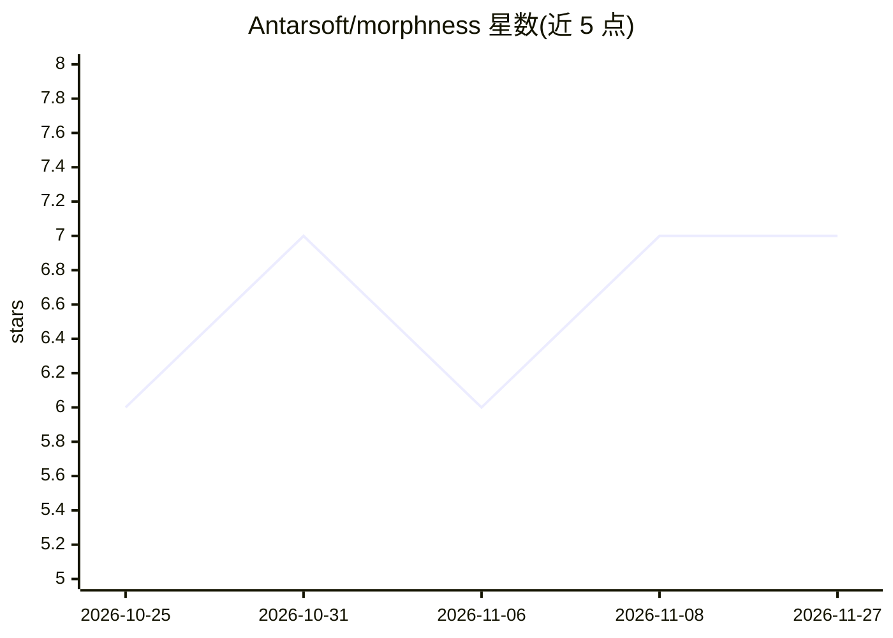

# Antarsoft/morphness

⭐ — · [GitHub]() · 组织维护

**Claude Code 的防护钩子与自学习 agent 流程套件**

面向 Claude Code 的开源 harness：核心是一个 PreToolUse 钩子 guard，在 Bash、文件、Grep、WebFetch 与 MCP 工具调用前进行检查，阻止可能破坏共享环境或泄露密钥的操作，部署/发布/合并前询问用户，无法完成检查时按 fail-closed 阻断。其上叠加流程：默认单个 Technical Lead 会话，风险路径变更引入 Full-stack 与 QA 子代理，retro 将失误转为规则，prune 审计规则并提议删减，规则以 Markdown 文件存于用户仓库。需要 bash、git、python3、awk、perl。

## 筛选速览

| 维度 | 判定 | 备注 |
|---|---|---|
| AI 角色 | `ai-ecosystem` | LLM/agent 周边工具 |
| 许可风险 | `permissive` | — |
| 部署形态 | `library` | 以包/库形式分发 |
| 模型依赖 | — | README 未给出锁定关系 |
| 硬件要求 | — | 无带数字的原话,不猜 |
| 安装摩擦 | `low` | 无编译、无系统依赖或容器化 |
| 成熟度 | — | 结构信号不足 |

## 能力要点

- PreToolUse 钩子拦截并解析 Bash 命令链、包装调用与 MCP 工具
- fail-closed 设计：检查无法运行时阻断调用
- retro/prune 循环将项目失误转为规则并删减永不触发的规则
- 规则与清单为仓库内纯 Markdown 文件，配置集中于 harness.config.yml

## 适用场景

- AI 编码代理操作共享环境时拦截误删分支、泄露密钥等事故
- 为已有 CLAUDE.md/AGENTS.md 的仓库沉淀可持续维护的代理规则
- 团队要求高风险变更（登录、支付、数据库）走计划与 QA 验证流程
- 按代理统计每个功能的成本估算

## 场景标签

`编码 Agent` `提示工程` · 领域:Agent 开发

## 证据(README 行号)

> L23: **Morphness** is an open-source harness for Claude Code. Its core is
> L30: rules. It is a set of subagents, `CLAUDE.md` / `AGENTS.md` rules, checklists and scripts for AI coding
> L146: - **Claude Code** with plugins, subagents (the Agent tool) and effort levels.

## 星数曲线

2026-10-25 6 → 2026-11-27 7（+1）

---
*卡片 v1 · prompt 1.4 · 生成 2026-11-20 · 置信度 mid · 依据 README sha `90a80ec55e68` · [字段定义](../../DATASET.md)*
