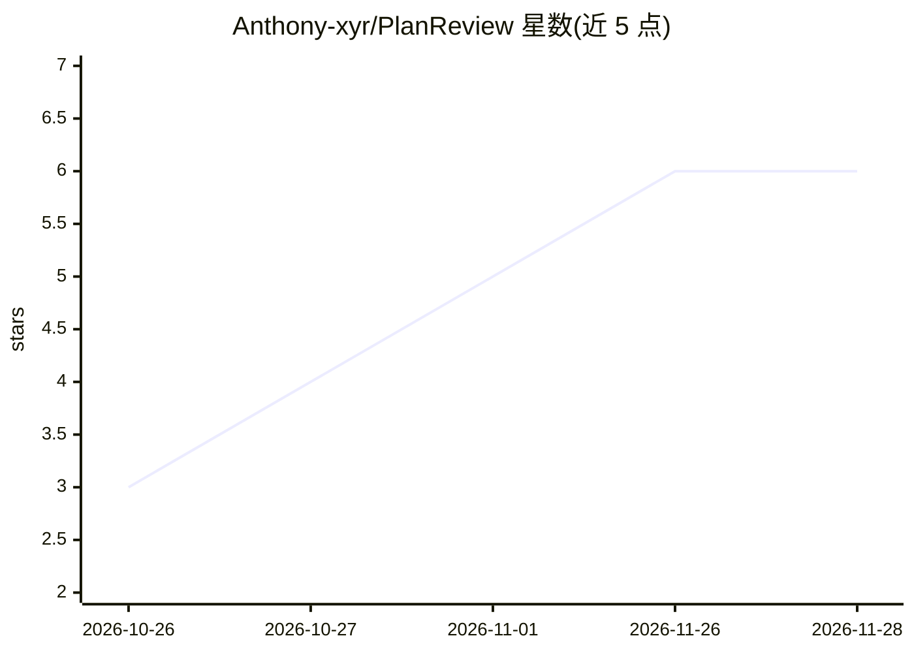

# Anthony-xyr/PlanReview

⭐ 6 · TypeScript · MIT · 推送 2026-11-25 · [GitHub](https://github.com/Anthony-xyr/PlanReview) · 个人维护 · 中文 README

**给个人用户做计划管理与 AI 时间复盘的桌面应用**

基于 Electron + React + TypeScript 的 Windows 桌面应用，数据存于本地 SQLite。功能覆盖速记收集（悬浮窗、全局快捷键）、双列时间轴的计划/实际对照与拖拽排程、课表导入（截图/PDF/Excel）、到点提醒与睡眠窗口、每日/每周复盘与个人画像。AI 功能包括速记解析、课表识别、周复盘建议与排程建议，通过设置页填写 OpenAI 兼容 API 接入，为可选配置；各任务可分别设置推理强度。提供安装包与源码构建两种途径。

## 筛选速览

| 维度 | 判定 | 备注 |
|---|---|---|
| AI 角色 | `ai-enhanced` | 去掉 AI 部分产品仍成立 |
| 许可风险 | `permissive` | MIT |
| 部署形态 | `desktop` | 安装包/桌面程序 |
| 模型依赖 | — | README 未给出锁定关系 |
| 硬件要求 | — | 无带数字的原话,不猜 |
| 安装摩擦 | `low` | 无编译、无系统依赖或容器化 |
| 成熟度 | — | 结构信号不足 |

## 能力要点

- 悬浮窗与全局快捷键速记，AI 自动提取日期、估时、类别、标签
- 课表导入支持截图、PDF、Excel，导入前可编辑校对
- AI 解析支持纠正与习惯学习，确认后记住用户写法
- 数据本地存储于 SQLite，卸载软件不删除数据

## 适用场景

- 记录灵感后自动整理成带时间的任务
- 对照计划与实际时间投入，生成周复盘建议
- 把教务系统导出的课表导入并纳入排程

## 场景标签

`AI 助手` · 领域:对话与助手

## 证据(README 行号)

> L3: 一款基于 Electron 的桌面应用,帮助你高效管理个人计划、实时追踪时间投入,并通过 AI 深度复盘优化时间利用效率。
> L77: 1. **设置 AI 服务** (可选,用于速记解析、课表导入、周复盘)
> L119: - **AI 集成**: OpenAI 兼容 API

## 星数曲线

2026-10-26 3 → 2026-11-28 6（+3）

---
*卡片 v1 · prompt 1.4 · 生成 2026-11-21 · 置信度 high · 依据 README sha `37c0ba19aa13` · [字段定义](../../DATASET.md)*
