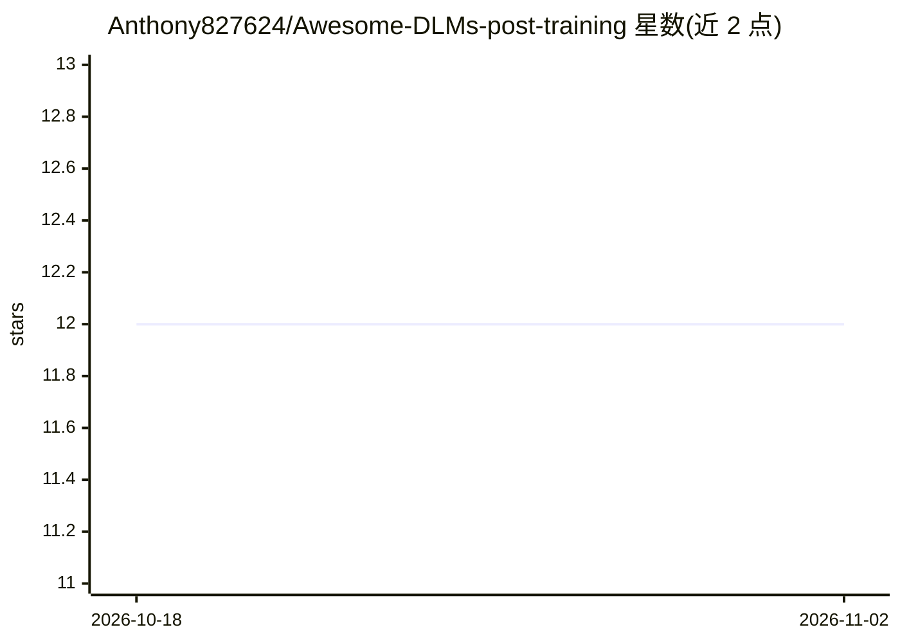

# Anthony827624/Awesome-DLMs-post-training

⭐ 12 · NOASSERTION · 推送 2026-09-11 · [GitHub](https://github.com/Anthony827624/Awesome-DLMs-post-training) · 个人维护

**扩散语言模型后训练论文与技术博客策展清单**

面向研究者与开发者的 awesome list：聚焦扩散语言模型（dLLM）的 post-training 阶段，收录论文与精选技术博客，按方法中心分类组织。覆盖基础模型（LLaDA、Dream、Mercury、Seed Diffusion 等）、SFT 与指令微调、偏好优化（DPO/KTO/IPO）、RL 与推理（GRPO/PPO）、安全对齐、蒸馏、推理加速、多模态与代码 dLLM 等类别。条目带 arXiv 与 AlphaXiv 徽章及 TL;DR 摘要，接受社区贡献。

## 筛选速览

| 维度 | 判定 | 备注 |
|---|---|---|
| AI 角色 | `ai-knowledge` | 知识聚合/清单类 |
| 许可风险 | `none` | NOASSERTION |
| 部署形态 | `None` |  |
| 模型依赖 | — | README 未给出锁定关系 |
| 硬件要求 | — | 无带数字的原话,不猜 |
| 安装摩擦 | `low` | 无编译、无系统依赖或容器化 |
| 成熟度 | — | 结构信号不足 |

## 能力要点

- 按方法中心的 post-training 分类组织（调查/基础模型/SFT/偏好优化/RL 等类别）
- 每条目附作者、TL;DR 摘要与 arXiv + AlphaXiv 徽章
- 覆盖 masked/absorbing、block、continuous 三类扩散语言模型
- 2026-09 更新增补 104 篇论文，含安全与对齐扩展

## 适用场景

- 查找扩散语言模型后训练方向的论文与综述
- 了解 dLLM 基础模型（LLaDA、Dream、Mercury 等）的演进
- 跟进 SFT、偏好优化与 RL 在扩散语言模型上的方法进展

## 场景标签

`精选清单` `科研工具` · 领域:学习与行业

## 证据(README 行号)

> L3: - **[2026-09]** ➕ Added 104 new papers: new base models (DiffusionGemma, LLaDA2.1, LLaDA MoE v2, Seed Diffusion, Mer
> L8: This list focuses on the **post-training** stage of Diffusion Language Models, i.e. everything that happens after (o
> L25: - Surveys (7)

## 星数曲线

2026-10-18 12 → 2026-11-02 12（+0）

---
*卡片 v1 · prompt 1.4 · 生成 2026-11-01 · 置信度 high · 依据 README sha `de8221e02bc6` · [字段定义](../../DATASET.md)*
