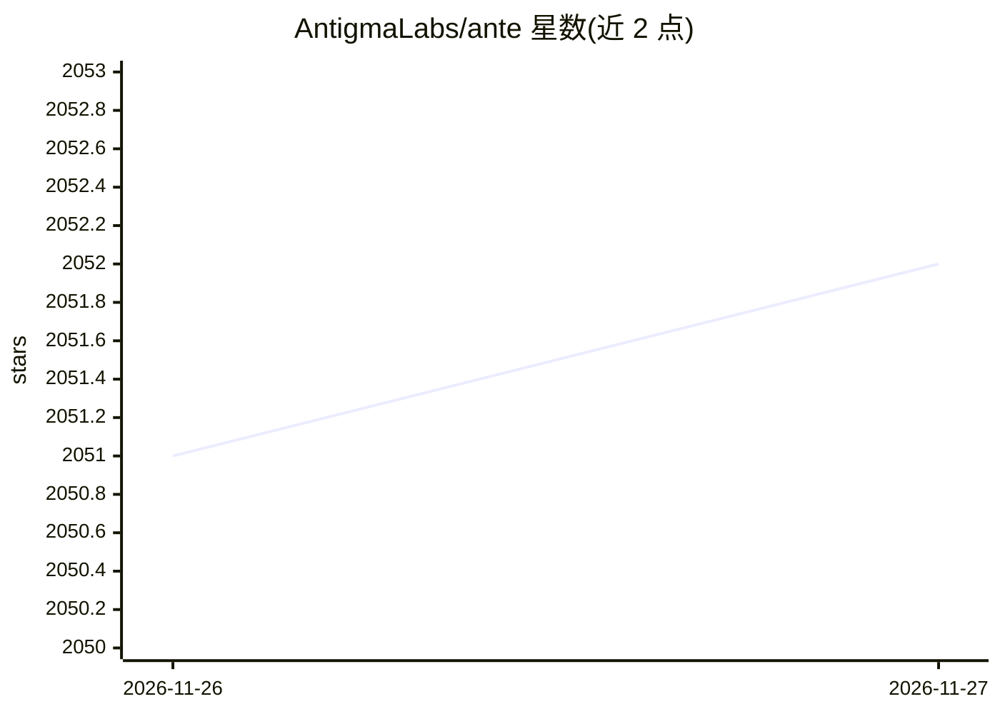

# AntigmaLabs/ante

⭐ 2,052 · Rust · Apache-2.0 · 推送 2026-11-26 · [GitHub](https://github.com/AntigmaLabs/ante) · [官网](https://ante.run) · 组织维护

**终端里的自包含 Rust 编码 agent，可离线跑本地模型**

Ante 是一个以单一 Rust 可执行文件分发的终端编码 agent：内置 Grep、git 等核心组件，无运行时依赖；通过 settings profile 声明式定义系统提示词、工具集、技能与记忆，可加载项目级 .ante/settings.json。自带托管推理引擎，指定本地 gguf 模型即可全离线运行，无需 API key 或账户；也支持 /providers 登录外部模型服务。运行模式包括交互 TUI、headless（CI/脚本）、stdio/socket 服务端与 Slack/Discord 网关；/term 可编排 Claude Code 等其他 agent CLI（需 tmux）。支持 macOS/Linux，Windows 走 WSL。

## 筛选速览

| 维度 | 判定 | 备注 |
|---|---|---|
| AI 角色 | `ai-native` | 本体是模型或模型工具 |
| 许可风险 | `permissive` | Apache-2.0 |
| 部署形态 | `library` | 以包/库形式分发 |
| 模型依赖 | — | README 未给出锁定关系 |
| 硬件要求 | — | 无带数字的原话,不猜 |
| 安装摩擦 | `low` | 无编译、无系统依赖或容器化 |
| 成熟度 | — | 结构信号不足 |

## 能力要点

- 单一 Rust 二进制（~15MB 压缩包，零运行时依赖），内置 Grep 与 git
- 内置推理引擎，--offline-model 指定本地 gguf 模型即可完全离线运行
- profile 机制整体替换设置文件，同一二进制可切换为不同 agent 形态
- ante serve / ante-acp（ACP）/ Rust SDK 支持编辑器与程序化接入

## 适用场景

- 在终端中让 agent 修复 bug、补测试、改代码，含 CI headless 模式
- 无 API key 环境下用本地模型跑编码任务
- 用 /term 同时编排多个 agent CLI 并比较回答
- 基于 ante-sdk 构建自定义 harness 或 Slack/Discord 机器人

## 场景标签

`编码 Agent` · 领域:编码与开发

## 证据(README 行号)

> L5: **A ghost in your shell.** Ante is a self-contained coding agent that lives in your terminal and self-organizes. One
> L7: It works like Claude Code or Codex, with none of their dependencies or model constraints. It can also be the optimiz
> L53: Ante ships with its own managed inference engine. Point it at a local model and the whole loop runs on your machine

## 星数曲线

2026-11-26 2,051 → 2026-11-27 2,052（+1）

---
*卡片 v1 · prompt 1.4 · 生成 2026-11-26 · 置信度 high · 依据 README sha `089d3c89c99c` · [字段定义](../../DATASET.md)*
