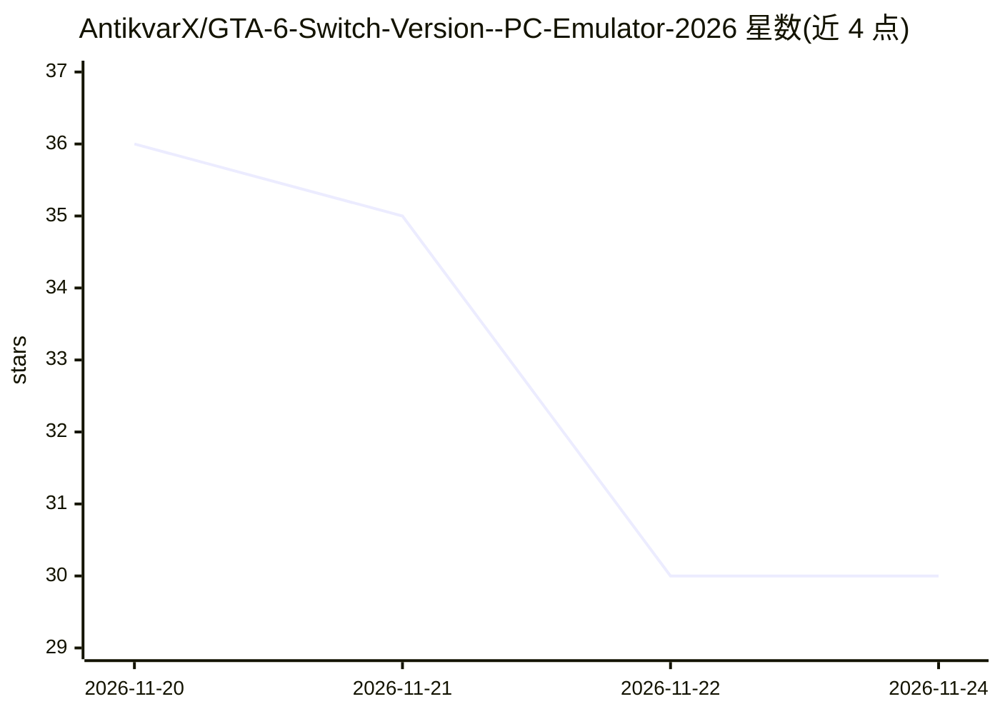

# AntikvarX/GTA-6-Switch-Version--PC-Emulator-2026

⭐ 30 · Rust · Apache-2.0 · 推送 2026-11-19 · [GitHub](https://github.com/AntikvarX/GTA-6-Switch-Version--PC-Emulator-2026) · 个人维护

**面向 Windows 玩家的 GTA VI PC 版安装准备指南与配套工具页**

面向 Windows 10/11 用户提供 GTA VI PC 版发布前的准备工作：Windows 系统更新检查、显卡驱动配置（NVIDIA/AMD/Intel 官方驱动页链接）、存储空间检查、Rockstar Games Launcher 准备，以及图形设置、FPS 排障、安装错误排查等通用 PC 游戏配置说明。README 明确声明该仓库的配套安装器不包含、也不安装 GTA VI 游戏文件，游戏本体需通过授权渠道获取；官方 PC 配置需求截至文中日期尚未公布，相关表格留空待更新。

## 筛选速览

| 维度 | 判定 | 备注 |
|---|---|---|
| AI 角色 | `ai-enhanced` | 去掉 AI 部分产品仍成立 |
| 许可风险 | `permissive` | Apache-2.0 |
| 部署形态 | `desktop` | 安装包/桌面程序 |
| 模型依赖 | — | README 未给出锁定关系 |
| 硬件要求 | — | 无带数字的原话,不猜 |
| 安装摩擦 | `low` | 无编译、无系统依赖或容器化 |
| 成熟度 | `idea` | |

## 能力要点

- Windows 兼容性准备清单（系统版本、DirectX、驱动、存储检查）
- NVIDIA/AMD/Intel 官方驱动下载指引
- 图形设置与 FPS/卡顿/显示问题的通用排障条目
- 官方 PC 版系统需求表格，标注为未确认待更新

## 适用场景

- 在 GTA VI PC 版发布前提前检查和准备 Windows 环境
- 排查 PC 游戏常见的低帧率、卡顿与安装报错
- 准备 Rockstar Games Launcher 并跟踪官方发布信息

## 场景标签

 · 领域:游戏/桌面工具

## 证据(README 行号)

> L34: The installer section is intended for a Windows setup companion associated with this project.
> L49: The companion installer does not contain or install GTA VI game files.

## 星数曲线

2026-11-20 36 → 2026-11-24 30（-6）

---
*卡片 v1 · prompt 1.4 · 生成 2026-11-20 · 置信度 low · 依据 README sha `6954d37a13d3` · [字段定义](../../DATASET.md)*
