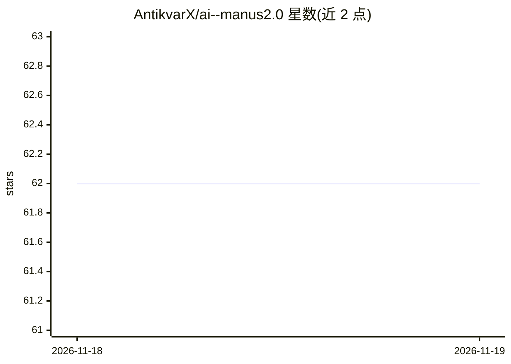

# AntikvarX/ai--manus2.0

⭐ 62 · Apache-2.0 · 推送 2026-11-18 · [GitHub](https://github.com/AntikvarX/ai--manus2.0) · 个人维护

**通用自主 AI Agent：代用户执行代码与浏览器操作完成任务**

README 介绍 Manus 为一个自主 AI Agent：可自主编写并执行脚本、控制浏览器导航网页/填写表单/采集信息，执行多步任务，并在后台作为个人助理运行。定位面向家庭、学习与轻量办公场景，目标用户包括学生、远程工作者与需要自动化日常小任务的人，强调无需开发者背景即可使用。README 提供 64 位系统、CPU/RAM 等兼容性要求表与使用流程说明；未给出源码、构建或依赖清单，安装方式仅见下载入口。

## 筛选速览

| 维度 | 判定 | 备注 |
|---|---|---|
| AI 角色 | `ai-native` | 本体是模型或模型工具 |
| 许可风险 | `permissive` | Apache-2.0 |
| 部署形态 | `None` |  |
| 模型依赖 | — | README 未给出锁定关系 |
| 硬件要求 | — | 无带数字的原话,不猜 |
| 安装摩擦 | `low` | 无编译、无系统依赖或容器化 |
| 成熟度 | — | 结构信号不足 |

## 能力要点

- 自主代码执行：agent 自行运行脚本完成任务
- 浏览器控制：导航网页、填写表单、采集信息
- 后台常驻的个人助理，跨会话记住工作流模式
- 提供 OS/CPU/RAM/存储/权限的兼容性要求表

## 适用场景

- 整理研究资料、运行小脚本、管理笔记
- 从多个网页采集数据并汇总信息
- 自动处理填表、文件整理等重复性日常事务
- 轻量办公中准备小型报告摘要

## 场景标签

`AI 助手` `浏览器自动化` · 领域:效率与自动化

## 证据(README 行号)

> L18: Manus is an autonomous AI agent designed to run code and control a browser on your behalf. Instead of acting like a
> L40: |**Processor (CPU)**|Dual-core CPU|Modern multi-core CPU for smooth Manus code automation|
> L41: |**Memory (RAM)**|4 GB|8 GB or more for heavy Manus autonomous tasks|

## 星数曲线

2026-11-18 62 → 2026-11-19 62（+0）

---
*卡片 v1 · prompt 1.4 · 生成 2026-11-19 · 置信度 mid · 依据 README sha `52f78133c85b` · [字段定义](../../DATASET.md)*
