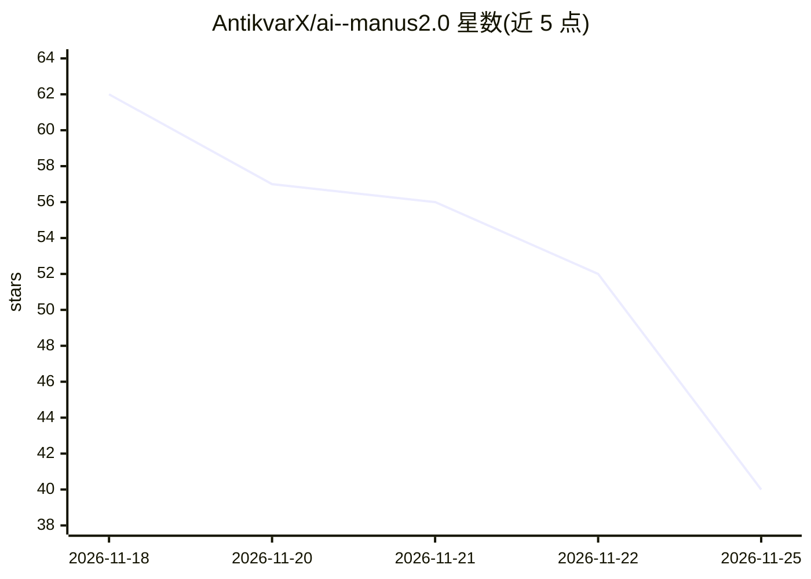

# AntikvarX/ai--manus2.0

⭐ 40 · Apache-2.0 · 推送 2026-11-19 · [GitHub](https://github.com/AntikvarX/ai--manus2.0) · 个人维护

**面向个人用户的自主 AI Agent，代用户执行代码与浏览器操作**

README 描述了一个名为 Manus 的自主 AI Agent：可自行编写并执行脚本、控制浏览器导航网页、填写表单、收集信息，并执行多步任务，定位为面向学生、远程办公者与个人项目的轻量助手，覆盖学习研究、家庭项目与轻办公等场景。README 提供硬件兼容性表格与上手步骤说明，但未给出源码、安装命令或任何接入与部署细节。

## 筛选速览

| 维度 | 判定 | 备注 |
|---|---|---|
| AI 角色 | `ai-native` | 本体是模型或模型工具 |
| 许可风险 | `permissive` | Apache-2.0 |
| 部署形态 | `None` |  |
| 模型依赖 | — | README 未给出锁定关系 |
| 硬件要求 | — | 无带数字的原话,不猜 |
| 安装摩擦 | `low` | 无编译、无系统依赖或容器化 |
| 成熟度 | — | 结构信号不足 |

## 能力要点

- 自主执行代码与脚本完成任务
- 控制浏览器进行网页导航、表单填写与信息收集
- 跨会话保持一致的任务处理行为

## 适用场景

- 自动整理研究资料并运行小脚本
- 从多个网页收集数据准备报告
- 把重复性的文件检查任务交给后台代理

## 场景标签

`AI 助手` `编码 Agent` `浏览器自动化` · 领域:效率与自动化

## 证据(README 行号)

> L10: - **Autonomous Code Execution:** Manus AI agent runs code on its own to complete tasks, so you can focus on decisio
> L18: Manus is an autonomous AI agent designed to run code and control a browser on your behalf. Instead of acting like a

## 星数曲线

2026-11-18 62 → 2026-11-25 40（-22）

---
*卡片 v1 · prompt 1.4 · 生成 2026-11-20 · 置信度 low · 依据 README sha `202c1bf76f25` · [字段定义](../../DATASET.md)*
