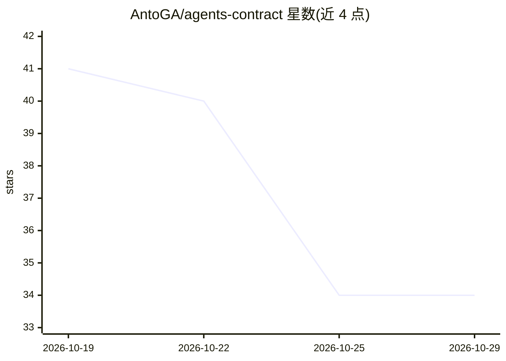

# AntoGA/agents-contract

⭐ 34 · Python · MIT · 推送 2026-10-19 · [GitHub](https://github.com/AntoGA/agents-contract) · [官网](https://cc-c.ru) · 个人维护 · 中文 README

**AGENTS.md 项目契约模板与零依赖 Python 校验工具链**

为 AI 编码 agent 提供项目规则契约方案：AGENTS.md 模板（Project/Commands/Conventions/Boundaries/Definition of Done 五个必需分节）、纯 Python 3.9+ 零依赖校验器（JSON 输出、CI 退出码、检查空占位符、疑似密钥、路径存在性与 32KiB 大小限制），以及 Claude Code 使用的 SessionStart 钩子（bash/PowerShell 版），在会话开始时向 agent 注入契约与测试状态。支持 Claude Code、Codex、Cursor、Copilot 等 agent，附 15 个单元测试与可复现的 A/B 基准脚本（仅测 Claude Code，5 次运行，作者自述样本量不足以达到统计显著性）。

## 筛选速览

| 维度 | 判定 | 备注 |
|---|---|---|
| AI 角色 | `ai-ecosystem` | LLM/agent 周边工具 |
| 许可风险 | `permissive` | MIT |
| 部署形态 | `library` | 以包/库形式分发 |
| 模型依赖 | — | README 未给出锁定关系 |
| 硬件要求 | — | 无带数字的原话,不猜 |
| 安装摩擦 | `low` | 无编译、无系统依赖或容器化 |
| 成熟度 | — | 结构信号不足 |

## 能力要点

- 校验器要求五个必需分节（Project/Commands/Conventions/Boundaries/Definition of Done）
- 零依赖纯 Python 校验器，支持 --strict、--json、--check-commands 与 monorepo 递归检查
- SessionStart 钩子将契约校验结果与测试状态注入 agent 上下文
- 提供可复现的 agent A/B 基准脚本（bench/）

## 适用场景

- 为代码仓库建立 AI agent 可读取的项目规则契约
- 在 CI 中校验 AGENTS.md/CLAUDE.md 的完整性与时效性
- 让 Claude Code 会话开始时自动获知契约状态与测试是否通过

## 场景标签

 · 领域:开发者工具/上下文工程

## 证据(README 行号)

> L5: Claude Code, Codex, Cursor, GitHub Copilot и другие агенты читают `AGENTS.md` (Claude Code читает `CLAUDE.md`, котор
> L19: |`scripts/agents_lint.py`|Линтер контракта (JSON-вывод, коды выхода для CI)|
> L80: При старте или возобновлении сессии Claude Code выполняет `scripts/session-start.sh`. Его вывод попадает агенту в к

## 星数曲线

2026-10-19 41 → 2026-10-29 34（-7）

---
*卡片 v1 · prompt 1.4 · 生成 2026-10-25 · 置信度 mid · 依据 README sha `76dbb2a4151a` · [字段定义](../../DATASET.md)*
