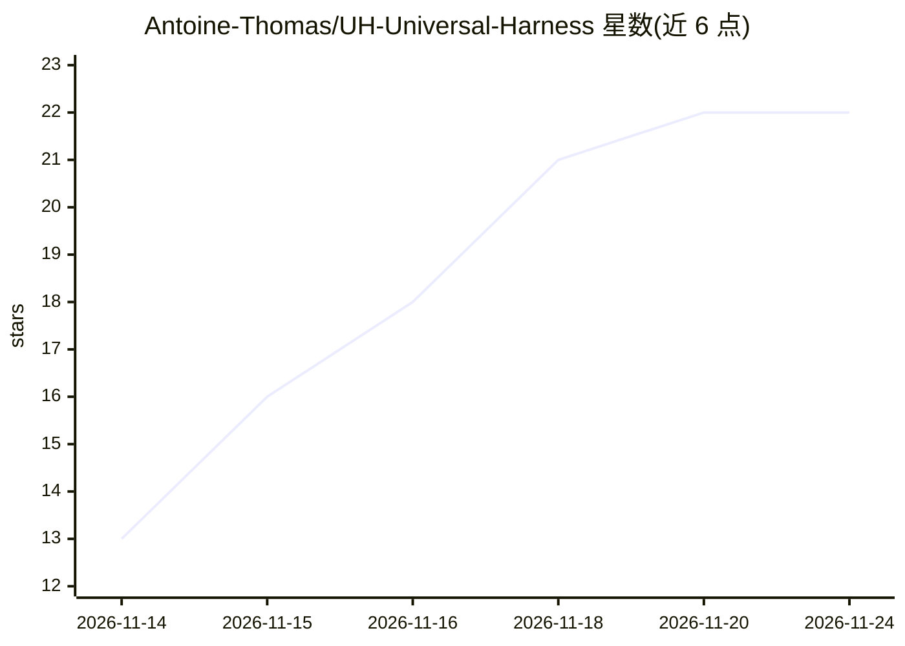

# Antoine-Thomas/UH-Universal-Harness

⭐ 22 · Python · MIT · 推送 2026-11-22 · [GitHub](https://github.com/Antoine-Thomas/UH-Universal-Harness) · 个人维护

**给桌面用户的本地优先 provider 无关 agent 运行框架**

Python 编写的 provider 无关 agent harness：提供同步 run_turn 工具循环、MCP 客户端、SQLite 会话存储（FTS5 全文检索）、记忆图、遥测、备份（S3 写/Google Drive 读）、夜间任务与浏览器驾驶舱 UI。路由链为 ollama→cloudflare→deepseek→omnirouter→免费 router，切换均打印在 stderr；无 Ollama 时可走云 key 或本地 TGI。仅一个运行时依赖 httpx，首启无需 API key，Web UI 限 127.0.0.1 并带进程级 token。

## 筛选速览

| 维度 | 判定 | 备注 |
|---|---|---|
| AI 角色 | `ai-ecosystem` | LLM/agent 周边工具 |
| 许可风险 | `permissive` | MIT |
| 部署形态 | `desktop` | 安装包/桌面程序 |
| 模型依赖 | local-ok | 支持本地模型 |
| 硬件要求 | — | 无带数字的原话,不猜 |
| 安装摩擦 | `low` | 无编译、无系统依赖或容器化 |
| 成熟度 | — | 结构信号不足 |

## 能力要点

- 同步 agent 循环 + JSON-schema 工具契约 + max_iterations 预算
- 可追溯的多 provider 回退链（ollama→cloudflare→deepseek→omnirouter→router）
- MCP 客户端：config.toml 挂 stdio MCP 服务器，按服务器白名单与大小上限
- uh web 三栏本地驾驶舱，uh router serve 提供 OpenAI 兼容本地端点

## 适用场景

- 本地优先地跑一个带工具调用的桌面 agent
- 通过 MCP 协议接入外部工具服务器
- 在多个本地/云模型 provider 间做可追溯的回退路由

## 场景标签

`Agent 框架` · 领域:Agent 开发

## 证据(README 行号)

> L8: A provider-agnostic agent harness in Python: a **cockpit** that opens as its own
> L44: - **Deterministic routing with a traced fallback** (from UHB). Ollama first,
> L181: - **Local gateway.** `uh router serve`: an OpenAI-compatible endpoint on

## 星数曲线

2026-11-14 13 → 2026-11-24 22（+9）

---
*卡片 v1 · prompt 1.4 · 生成 2026-11-18 · 置信度 mid · 依据 README sha `b2c063aa76c6` · [字段定义](../../DATASET.md)*
