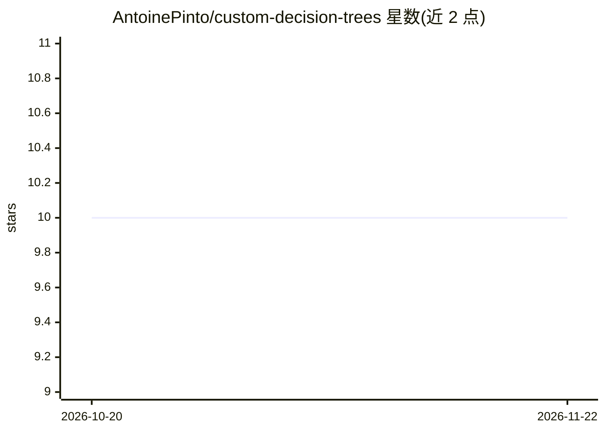

# AntoinePinto/custom-decision-trees

⭐ 10 · Python · MIT · 推送 2026-07-08 · [GitHub](https://github.com/AntoinePinto/custom-decision-trees) · [官网](https://pypi.org/project/custom-decision-trees) · 个人维护

**为 ML 从业者提供可自定义分裂准则的决策树与随机森林库**

Python 包，用于构建决策树与随机森林模型，支持以 Python 类形式定义自定义分裂准则（含 compute_metric 与 compute_delta 方法），分裂过程按所定义指标优化，适用于成本敏感场景；另支持多条件节点分裂、分类与回归、多分类、字符串型解释变量、并行计算及每节点分裂测试数控制。通过 pip 安装，使用 fit/predict_proba 接口训练与预测，并提供 print_tree/plot_tree 展示树结构，示例见 /notebooks 文件夹。

## 筛选速览

| 维度 | 判定 | 备注 |
|---|---|---|
| AI 角色 | `ai-native` | 本体是模型或模型工具 |
| 许可风险 | `permissive` | MIT |
| 部署形态 | `library` | 以包/库形式分发 |
| 模型依赖 | — | README 未给出锁定关系 |
| 硬件要求 | — | 无带数字的原话,不猜 |
| 安装摩擦 | `low` | 无编译、无系统依赖或容器化 |
| 成熟度 | — | 结构信号不足 |

## 能力要点

- 以 Python 类定义自定义分裂准则，按自定义指标优化分裂
- 支持多条件同时满足的节点分裂
- 支持分类、回归、多分类与字符串型解释变量
- 支持并行计算（n_jobs）与分裂计算量控制参数

## 适用场景

- 交易涨跌分类中按经济收益最大化来指导分裂
- 流失预测中通过 F1 或召回率减少漏报
- 反欺诈中按欺诈交易占比优化分裂
- 营销活动中最大化目标客群的预期收益

## 场景标签

 · 领域:机器学习工具库

## 证据(README 行号)

> L10: **Custom Decision Trees** is a Python package that lets you build Decision Trees / Random Forests models with advan
> L16: Define your own cutting criteria in Python language (documentation in the following sections).

## 星数曲线

2026-10-20 10 → 2026-11-22 10（+0）

---
*卡片 v1 · prompt 1.4 · 生成 2026-11-20 · 置信度 high · 依据 README sha `db1ee04c561e` · [字段定义](../../DATASET.md)*
