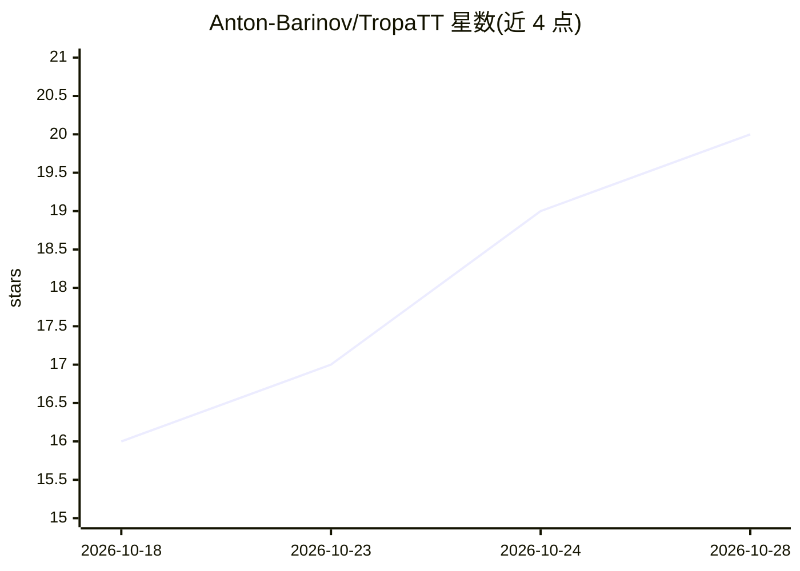

# Anton-Barinov/TropaTT

⭐ 20 · PHP · AGPL-3.0 · 推送 2026-10-27 · [GitHub](https://github.com/Anton-Barinov/TropaTT) · [官网](https://tropatt.com) · 个人维护 · 中文 README

**自托管的开源 CRM 与工作管理一体化平台（PHP/MySQL，含 AI 工作流）**

基于 PHP 8.1+ 与 MySQL/MariaDB 的自托管开源（AGPL-3.0）工作平台，将 CRM、任务与项目管理（Kanban/Gantt）、团队聊天、知识库 wiki、客户门户、费率账单、电商 CMS 网关、REST API 与自动化整合在一个应用内。AI 部分：内置 MCP 服务器（暴露 621 个工具、6 个资源，RBAC 权限），支持 Claude Code、Cursor、ChatGPT 等 agent 接入，并提供 28 个 AI 工作流（创意分析生成任务层级、日/周计划、摘要与风险评估，BYO keys）。通过浏览器安装器部署，可在 $2–3/月共享主机上运行，无外部 PHP 依赖，暂无官方 Docker 镜像。面向自由职业者、小团队、代理商与企业。

## 筛选速览

| 维度 | 判定 | 备注 |
|---|---|---|
| AI 角色 | `ai-enhanced` | 去掉 AI 部分产品仍成立 |
| 许可风险 | `dual` | AGPL-3.0 |
| 部署形态 | `desktop` | 安装包/桌面程序 |
| 模型依赖 | — | README 未给出锁定关系 |
| 硬件要求 | — | 无带数字的原话,不猜 |
| 安装摩擦 | `low` | 无编译、无系统依赖或容器化 |
| 成熟度 | — | 结构信号不足 |

## 能力要点

- 内置 MCP 服务器（621 工具 / 6 资源，RBAC 与 compact 密度模式）
- 28 个 AI 工作流：想法转任务层级、日/周计划、摘要、风险评估（自带 API key）
- CRM+任务+Kanban+Gantt+聊天+Wiki+客户门户单一应用，AGPL-3.0 无按席位收费
- 零外部 PHP 依赖，浏览器安装，可运行于 $2–3/月共享主机

## 适用场景

- 把客户、任务、聊天、日历从多个订阅应用合并到一个自托管系统
- 让 AI 编码 agent 通过 MCP 直接读写我的 CRM 数据
- 多店铺电商商家跨 11 个平台同步订单与库存（可选模块）

## 场景标签

`工作流自动化` · 领域:效率与自动化

## 证据(README 行号)

> L3: **TropaTT is a free, self-hosted, open-source CRM and work-management platform built on PHP and MySQL. It combines C
> L65: - **Actual AI that helps you work.** Not a chatbot sidebar. AI idea analysis turns a sentence like "client wants a 
> L66: - **Built-in Model Context Protocol (MCP) server.** Connect Claude Code, Cursor, Codex, OpenDevin, ChatGPT, and oth

## 星数曲线

2026-10-18 16 → 2026-10-28 20（+4）

---
*卡片 v1 · prompt 1.4 · 生成 2026-10-28 · 置信度 high · 依据 README sha `6e3c615a6fa8` · [字段定义](../../DATASET.md)*
