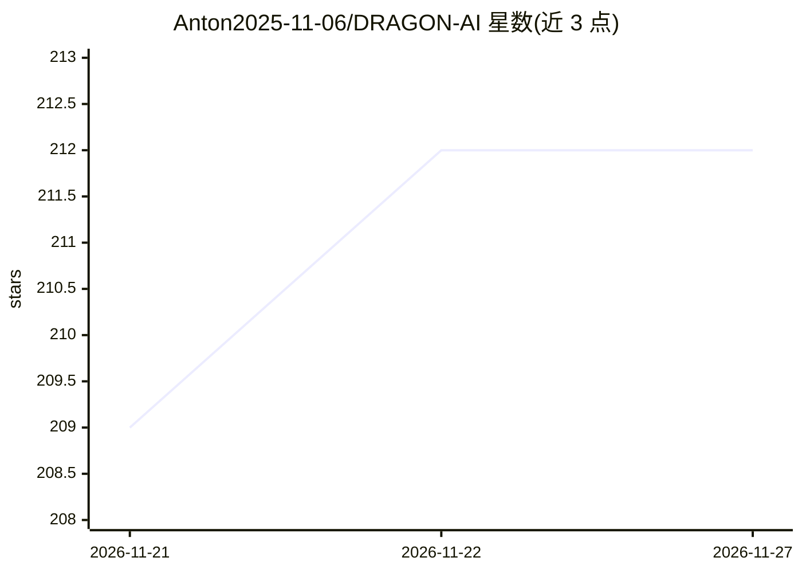

# Anton2025-11-06/DRAGON-AI

⭐ 212 · Vue · Apache-2.0 · 推送 2026-11-25 · [GitHub](https://github.com/Anton2025-11-06/DRAGON-AI) · 个人维护 · 中文 README

**可私有部署的多租户企业 AI 中台：网关+RAG+工作流+智能体**

面向企业私有化部署场景的 AI 中台，将模型网关、知识库 RAG、知识图谱、可视化工作流编排（21 类节点、人工审批）、AgentScope ReAct 深度探索智能体（每用户云沙箱与持久化工作区）与企业级 RBAC/ACL 权限治理整合在同一平台。后端为 Python 3.11 + FastAPI 微服务（六服务 + arq 四条 worker 流水线），前端 Vue 3 + vben。部署依赖 MySQL、Redis、Nacos（必须有）、Elasticsearch、Neo4j；OpenSandbox 沙箱为可选。数据集/训练/推理等模块仅预留骨架，尚未实现。

## 筛选速览

| 维度 | 判定 | 备注 |
|---|---|---|
| AI 角色 | `ai-ecosystem` | LLM/agent 周边工具 |
| 许可风险 | `permissive` | Apache-2.0 |
| 部署形态 | `self-host` | docker 或自建部署 |
| 模型依赖 | — | README 未给出锁定关系 |
| 硬件要求 | — | 无带数字的原话,不猜 |
| 安装摩擦 | `low` | 无编译、无系统依赖或容器化 |
| 成熟度 | `idea` | |

## 能力要点

- OpenAI 兼容模型网关统一接入 12 类能力 × 3 家供应商（OpenAI 兼容/通义千问/智谱），带申请审批与 API Key 流程
- 混合检索：BM25 + dense kNN 动态加权，可叠加 Neo4j 图谱检索，附 RAGAS 5 指标评测
- AgentScope ReAct 智能体 + 每用户独立云沙箱与持久化工作区，产物在对话内在线预览
- RBAC + 七类资源级 ACL + 审计日志 + 限流，arq 四流水线独立消费可横向扩展

## 适用场景

- 企业内部搭建可控权限的私有化 AI 应用平台
- 构建带审批与知识检索的可视化业务工作流
- 为团队提供统一的多供应商模型接入网关
- 部署带沙箱执行环境的任务型智能体

## 场景标签

`模型网关` `RAG` `工作流自动化` `知识图谱` · 领域:Agent 开发

## 证据(README 行号)

> L1: # 🐉 DRAGON-AI — 可私有部署的多租户 AI 中台
> L3: > 把 **模型网关、知识库 RAG、知识图谱、工作流编排、深度探索智能体（Harness）与企业级 RBAC** 收进同一个工作区，数据、模型与权限都由你自己掌握。
> L20: |模型网关与模型广场|统一接入、分发、治理多供应商模型|OpenAI 兼容入口、12 类能力 × 3 供应商、申请审批、API Key|

## 星数曲线

2026-11-21 209 → 2026-11-27 212（+3）

---
*卡片 v1 · prompt 1.4 · 生成 2026-11-25 · 置信度 high · 依据 README sha `46b961c84409` · [字段定义](../../DATASET.md)*
