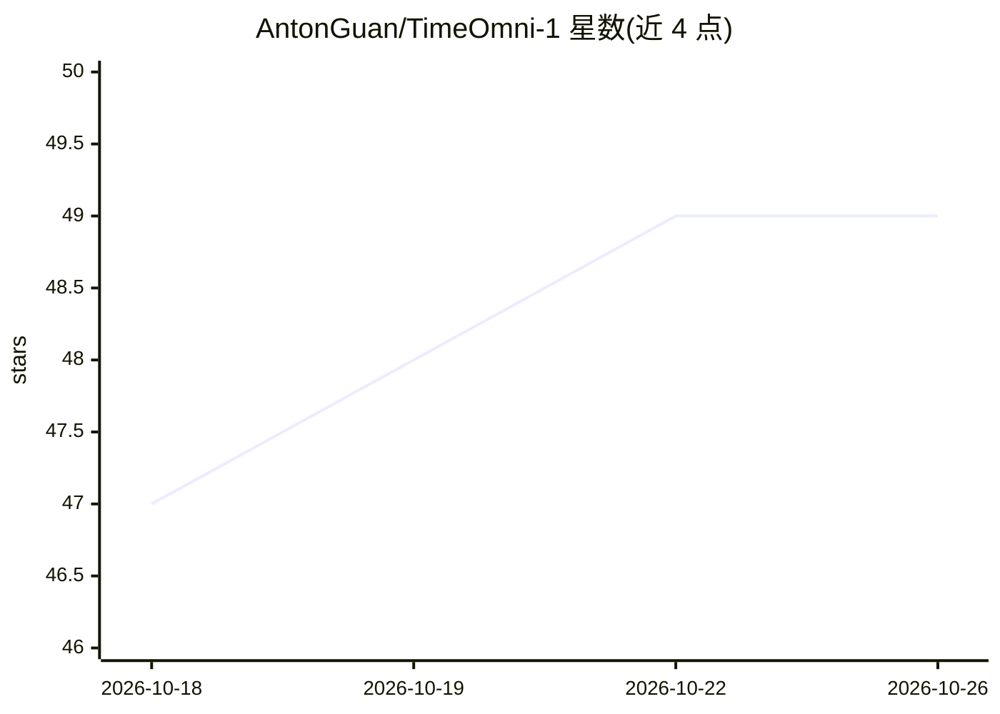

# AntonGuan/TimeOmni-1

⭐ 49 · Python · Apache-2.0 · 推送 2026-06-12 · [GitHub](https://github.com/AntonGuan/TimeOmni-1) · [官网](https://arxiv.org/abs/2509.24803) · 组织维护

**时间序列推理大模型：在 LLM 中激励复杂时序推理**

ICLR 2026 论文 TimeOmni-1 的官方实现仓库，提供安装、模型下载、推理与评测脚本。模型基于 Qwen2.5/Qwen3.5 后训练，发布 4B/7B/9B 三个检查点到 Hugging Face，覆盖 TSR-Suite 四类任务：场景理解、因果发现、事件感知预测与决策。README 给出 conda+pip 安装流程、单题推理命令（think/answer 输出格式）与 ID/OOD 评测脚本；4B/9B 为 VLM 底座，推理时仅加载语言模型权重，vLLM JIT 编译需要 ninja 构建工具。附 Hugging Face Spaces 在线演示。

## 筛选速览

| 维度 | 判定 | 备注 |
|---|---|---|
| AI 角色 | `ai-native` | 本体是模型或模型工具 |
| 许可风险 | `permissive` | Apache-2.0 |
| 部署形态 | `library` | 以包/库形式分发 |
| 模型依赖 | local-ok | 支持本地模型 |
| 硬件要求 | — | 无带数字的原话,不猜 |
| 安装摩擦 | `medium` | 含编译或系统依赖之一 |
| 成熟度 | — | 结构信号不足 |

## 能力要点

- 提供 7B(Qwen2.5)/4B/9B(Qwen3.5) 三个后训练检查点的下载脚本
- 单题推理脚本支持本地快照路径或 HF repo id，自动选择加载器
- TSR-Suite 四任务评测脚本，指标含 ACC/MAE 与 Success Rate
- 4B/9B 使用 linear (gated-delta-net) 注意力，vLLM JIT 编译需 ninja

## 适用场景

- 运行时间序列推理任务的推理与评测
- 复现论文中 ID/OOD 基准结果
- 在 Hugging Face Spaces 上试用模型演示

## 场景标签

`模型评测` · 领域:评测与运维

## 证据(README 行号)

> L3: (ICLR'26) TimeOmni-1: Incentivizing Complex Reasoning with Time Series in Large Language Models
> L158: python install/download_hf_model.py --model 7B   # anton-hugging/TimeOmni-1-7B (Qwen2.5)
> L188: python inference/inference.py \

## 星数曲线

2026-10-18 47 → 2026-10-26 49（+2）

---
*卡片 v1 · prompt 1.4 · 生成 2026-10-25 · 置信度 high · 依据 README sha `03524c47df78` · [字段定义](../../DATASET.md)*
