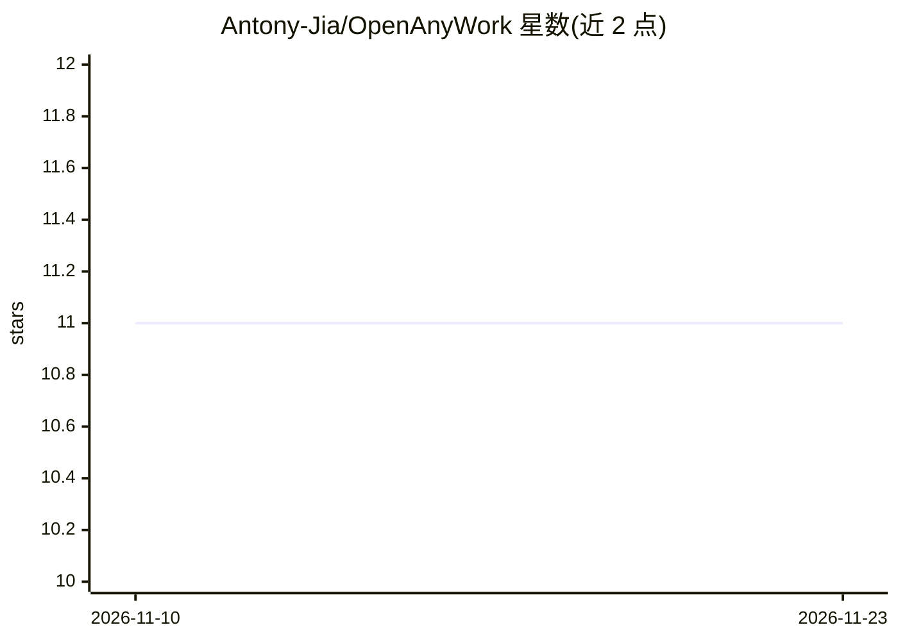

# Antony-Jia/OpenAnyWork

⭐ 11 · JavaScript · MIT · 推送 2026-05-06 · [GitHub](https://github.com/Antony-Jia/OpenAnyWork) · [官网](https://openanywork.cn) · 个人维护 · 中文 README

**面向深度 Agent 的桌面工作台：本地工具调用与任务编排**

langchain-ai/openwork 的维护分支，为 Deep Agents 提供桌面工作台，使 agent 能在本地工作区调用工具、执行任务与编排工作流。提供 Classic（会话流）与 Butler（编排）双工作区模式，支持文件系统访问、Docker 隔离执行、MCP 服务器管理、子 Agent 配置、HITL 审批、语音输入输出、SQLite 本地存储与记忆系统。Docker 管理入口目前仅限 Windows；本地数据默认存放于 ~/.openwork/。

## 筛选速览

| 维度 | 判定 | 备注 |
|---|---|---|
| AI 角色 | `ai-ecosystem` | LLM/agent 周边工具 |
| 许可风险 | `permissive` | MIT |
| 部署形态 | `library` | 以包/库形式分发 |
| 模型依赖 | — | README 未给出锁定关系 |
| 硬件要求 | — | 无带数字的原话,不猜 |
| 安装摩擦 | `low` | 无编译、无系统依赖或容器化 |
| 成熟度 | — | 结构信号不足 |

## 能力要点

- Classic 与 Butler 双工作区模式，支持 6 种线程类型（default/ralph/email/loop/expert/butler）
- 集成 MCP 服务器配置与工具发现、子 Agent 系统、HITL 审批与中断
- Docker 隔离执行与挂载文件视图（管理入口目前仅 Windows）
- 本地 SQLite 存储（线程/记忆/检查点）与自动会话摘要、每日画像

## 适用场景

- 在本地工作区让 agent 调用工具完成多步骤任务
- 通过 Butler 编排带依赖关系的多任务调度与日历/邮件/RSS 监控
- 配置子 Agent、技能与 MCP 服务器扩展 agent 能力

## 场景标签

`Agent 框架` `多智能体` · 领域:Agent 开发

## 证据(README 行号)

> L5: > This project is a fork of langchain-ai/openwork. The original repository is no longer actively maintained, and thi
> L7: OpenAnyWork is a desktop workbench for Deep Agents: not just chat, but enabling agents to invoke tools, execute task
> L119: - `MCP`: Server configuration, start/stop, tool discovery, scope switches.

## 星数曲线

2026-11-10 11 → 2026-11-23 11（+0）

---
*卡片 v1 · prompt 1.4 · 生成 2026-11-19 · 置信度 high · 依据 README sha `afb30dd16bfb` · [字段定义](../../DATASET.md)*
