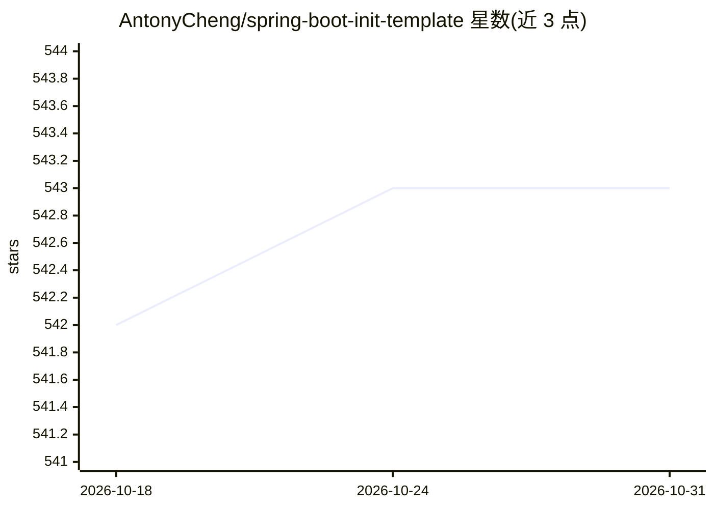

# AntonyCheng/spring-boot-init-template

⭐ 543 · Java · Apache-2.0 · 推送 2026-05-12 · [GitHub](https://github.com/AntonyCheng/spring-boot-init-template) · 个人维护 · 中文 README

**整合 Spring AI 的 Java Web 后端初始化模板，开箱即用**

基于 SpringBoot 3.2.5 的 Java Web 项目初始化模板，整合 MyBatis-Plus、ShardingSphere、Redis、RabbitMQ、Elasticsearch、SaToken、MongoDB、对象存储等常用框架，并集成 Spring AI 1.1.0 以接入 OpenAI、智谱与 Ollama 模型。广泛支持 JDK11/JDK17，部分分支兼容 JDK8。功能按需启停，通过修改 yaml 配置激活缓存、消息队列、搜索等模块，提供 Docker Compose 部署脚本与前端 vue-admin-template，适用于前后端分离项目启动开发与入门学习。

## 筛选速览

| 维度 | 判定 | 备注 |
|---|---|---|
| AI 角色 | `ai-ecosystem` | LLM/agent 周边工具 |
| 许可风险 | `permissive` | Apache-2.0 |
| 部署形态 | `self-host` | docker 或自建部署 |
| 模型依赖 | local-ok | 支持本地模型 |
| 硬件要求 | — | 无带数字的原话,不猜 |
| 安装摩擦 | `low` | 无编译、无系统依赖或容器化 |
| 成熟度 | — | 结构信号不足 |

## 能力要点

- 集成 Spring AI 1.1.0，支持 OpenAI、智谱清言与 Ollama 本地模型
- 整合 MyBatis-Plus、ShardingSphere、Redis、RabbitMQ、Elasticsearch、SaToken 等常用框架
- 各功能模块按需启停，配置文件以 todo 标识修改位置
- 提供 Docker Compose 一键部署脚本与前端 vue-admin-template

## 适用场景

- 在模板基础上快速启动前后端分离项目的后端开发
- 直接获得缓存、消息队列、搜索、鉴权等常用能力的预置集成
- 在 Java 项目中通过 Spring AI 接入大语言模型

## 场景标签

 · 领域:Web 开发/后端脚手架

## 证据(README 行号)

> L15: **基于 Java Web 项目的 SpringBoot 框架初始化模板**，该模板整合了常用的框架，广泛支持JDK11和JDK17，部分版本兼容JDK8，该模板适用于前后端分离项目启动开发，保证大家在此基础上能够快速开发自己的项
> L48: - **Spring AI 1.1.0**
> L118: - Spring AI 接入大语言模型（OpenAI、智谱清言以及Ollama本地大模型）

## 星数曲线

2026-10-18 542 → 2026-10-31 543（+1）

---
*卡片 v1 · prompt 1.4 · 生成 2026-10-21 · 置信度 high · 依据 README sha `bb374e09d2b3` · [字段定义](../../DATASET.md)*
