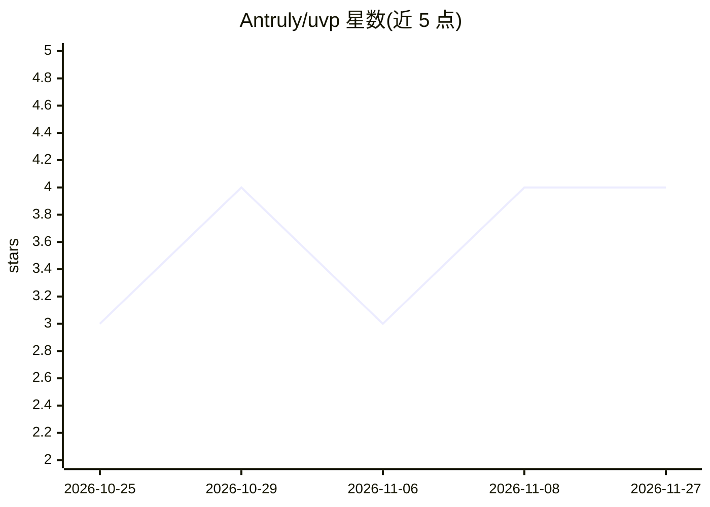

# Antruly/uvp

⭐ 4 · TypeScript · MIT · 推送 2026-11-26 · [GitHub](https://github.com/Antruly/uvp) · [官网](https://ssvr.top/projects/uvp) · 个人维护 · 中文 README

**供开发者与 AI agent 用一个 CLI/MCP 构建、运行并验证 libuvcpp C++ Web 服务**

uvp 将一段 C++ Web 服务描述转换为完整的 CMake 工程，针对 libuvcpp 构建、启动服务、发起真实请求，并返回区分「观察到」「推导出」「无法确认」三类信息的验证报告。它同时提供 CLI 与 MCP server，共享同一套 22 个工具契约，agent 与 shell 脚本获得相同行为。生成的代码是普通 libuvcpp C++，离开 uvp 后仍可用 cmake 独立构建。项目处于 pre-1.0 阶段，要求 Node.js 22+/C++14 工具链/CMake 3.20+/libuvcpp 1.7.0+。

## 筛选速览

| 维度 | 判定 | 备注 |
|---|---|---|
| AI 角色 | `ai-enhanced` | 去掉 AI 部分产品仍成立 |
| 许可风险 | `permissive` | MIT |
| 部署形态 | `desktop` | 安装包/桌面程序 |
| 模型依赖 | — | README 未给出锁定关系 |
| 硬件要求 | — | 无带数字的原话,不猜 |
| 安装摩擦 | `medium` | 含编译或系统依赖之一 |
| 成熟度 | `idea` | |

## 能力要点

- CLI 与 MCP server 共享 22 个工具契约，行为与证据一致
- 四阶段流程（描述→生成→构建运行→压测报告）每步产出证据
- uvp doctor 检查工具链缺口并说明各缺口阻塞的能力
- 支持 7 个模板与 tls/http2/http3/websocket/soap/db 等特性开关

## 适用场景

- 让 agent 从一句话描述生成并验证一个 JSON API 服务
- 在终端用一条命令完成脚手架、构建、启动与断言验证
- 对生成服务做 HTTP/1.1/2/3、WebSocket、SOAP 探测与压测
- 录制并回放请求会话，对比两次验证报告的差异

## 场景标签

`代码生成` · 领域:编码与开发

## 证据(README 行号)

> L5: ### One MCP for building, running, and verifying libuvcpp-powered C++ web services.
> L23: uvp turns a description of a C++ web service into a real CMake project, builds it
> L28: It is one CLI and one MCP server. The same 22 tool contracts back both, so

## 星数曲线

2026-10-25 3 → 2026-11-27 4（+1）

---
*卡片 v1 · prompt 1.4 · 生成 2026-11-21 · 置信度 high · 依据 README sha `018475112494` · [字段定义](../../DATASET.md)*
