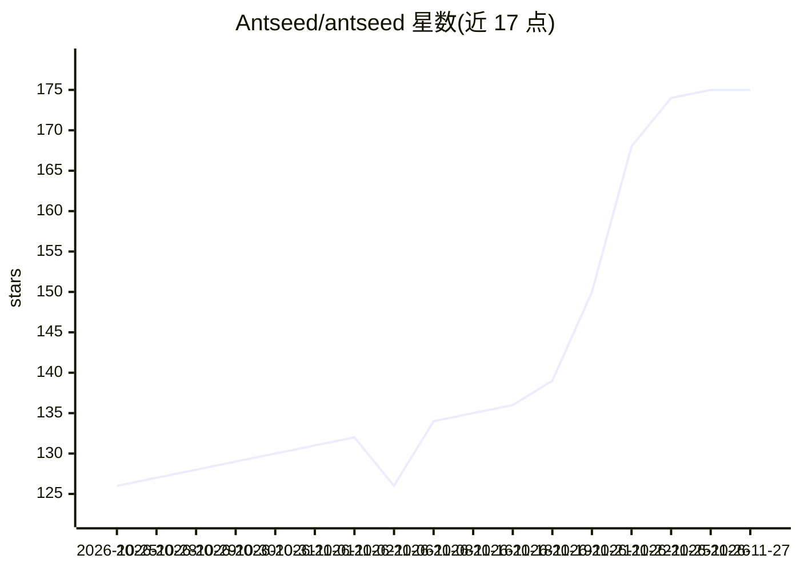

# Antseed/antseed

⭐ 175 · TypeScript · GPL-3.0 · 推送 2026-11-26 · [GitHub](https://github.com/Antseed/antseed) · [官网](https://antseed.com) · 组织维护

**连接买家与提供者的 P2P 开放 LLM 推理网络**

Antseed 是一个去中心化推理交易网络：提供者运行 provider 插件接入上游 LLM API（Anthropic、OpenAI 兼容 API、本地 Ollama）并在 DHT 网络上宣告容量；买家运行 router 插件发现提供者、按价格/延迟/声誉打分，并通过本地 HTTP 端点代理请求，该端点可替换 ANTHROPIC_BASE_URL 或 OPENAI_BASE_URL。支付采用 Base/Arbitrum 链上 USDC，P2P 使用 BitTorrent DHT 发现与端到端加密 TCP/WebRTC。提供 Prometheus 兼容指标导出与 npm 插件开发机制。条款禁止转售订阅凭证。

## 筛选速览

| 维度 | 判定 | 备注 |
|---|---|---|
| AI 角色 | `ai-ecosystem` | LLM/agent 周边工具 |
| 许可风险 | `viral` | GPL-3.0 |
| 部署形态 | `library` | 以包/库形式分发 |
| 模型依赖 | local-ok | 支持本地模型 |
| 硬件要求 | — | 无带数字的原话,不猜 |
| 安装摩擦 | `low` | 无编译、无系统依赖或容器化 |
| 成熟度 | — | 结构信号不足 |

## 能力要点

- provider/router 双角色插件架构，可替换 ANTHROPIC/OPENAI_BASE_URL 的本地代理端点
- BitTorrent DHT 容量发现 + 端到端加密 TCP/WebRTC 传输
- Base/Arbitrum 链上 USDC 存款与会话计费
- 内置 Prometheus 兼容指标导出与插件脚手架

## 适用场景

- 把自己接入的 LLM API 容量在网络上按请求计价供给他人
- 作为买家按价格/延迟/声誉自动选择推理提供者
- 用插件机制封装自有模型或差异化服务接入网络

## 场景标签

`推理引擎` · 领域:训练与推理

## 证据(README 行号)

> L11: **Providers** run a provider plugin that connects to an upstream LLM API (Anthropic, OpenAI-compatible APIs, local 
> L13: **Buyers** run a router plugin that discovers providers, scores them on price/latency/reputation, and proxies reque
> L5: We're building the world's largest inference liquidity network, where anyone can supply intelligence and everyone ca

## 星数曲线

2026-10-25 126 → 2026-11-27 175（+49）

---
*卡片 v1 · prompt 1.4 · 生成 2026-11-26 · 置信度 high · 依据 README sha `963544038e78` · [字段定义](../../DATASET.md)*
