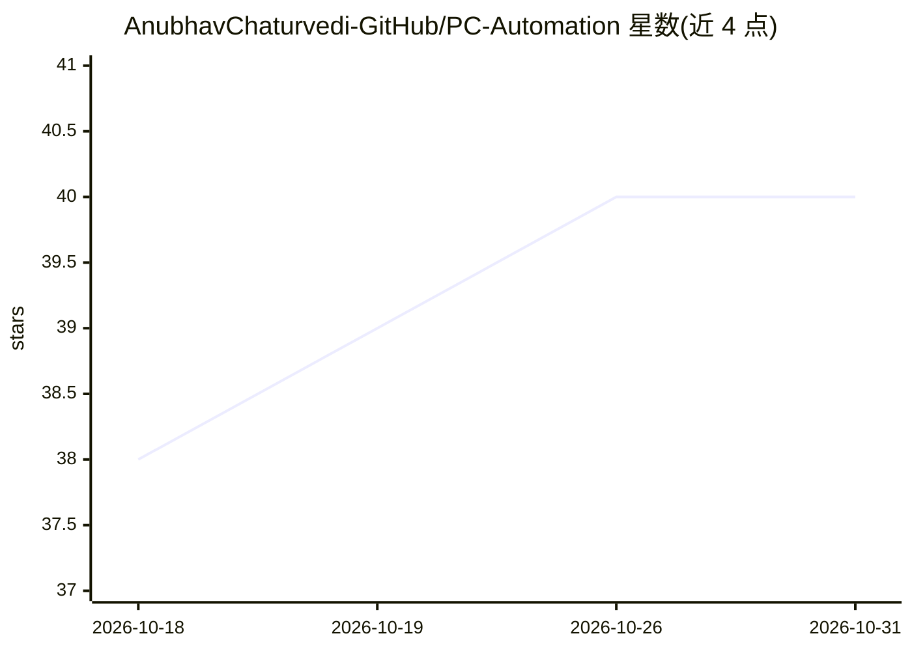

# AnubhavChaturvedi-GitHub/PC-Automation

⭐ 40 · Python · 推送 2026-08-12 · [GitHub](https://github.com/AnubhavChaturvedi-GitHub/PC-Automation) · [官网](https://www.youtube.com/@NetHyTech) · 个人维护

**让 AI agent 直接操控 macOS 的零依赖 Python CLI**

仅用 Python 标准库实现的 macOS 控制命令行工具：提供音量、亮度、应用启停、浏览器标签、媒体播放、截图、剪贴板、通知、TTS 与麦克风/扬声器测试等动词目录，每条命令为单次子进程调用并返回结构化输出。设计上不做意图理解，由 AI agent 负责决策、CLI 负责执行；可 git clone 到 ~/.claude/skills 作为 Claude Code 技能使用。需要 macOS 隐私权限（辅助功能、屏幕录制、麦克风），doctor 命令报告能力与权限状态。

## 筛选速览

| 维度 | 判定 | 备注 |
|---|---|---|
| AI 角色 | `ai-ecosystem` | LLM/agent 周边工具 |
| 许可风险 | `none` | — |
| 部署形态 | `library` | 以包/库形式分发 |
| 模型依赖 | locked-api |  |
| 硬件要求 | — | 无带数字的原话,不猜 |
| 安装摩擦 | `low` | 无编译、无系统依赖或容器化 |
| 成熟度 | — | 结构信号不足 |

## 能力要点

- 零第三方依赖、无守护进程、无交互提示
- 覆盖系统状态、应用、浏览器、媒体、截图、剪贴板、通知/TTS 等动词目录
- doctor 命令检测各能力可用性与 macOS 权限状态
- 以 git clone 方式安装为 Claude Code 技能

## 适用场景

- 让 Claude Code 等 agent 通过对话控制我的 Mac
- 为自主 agent 提供确定性的桌面操作工具层
- 检查并授予 macOS 自动化所需权限

## 场景标签

`GUI 自动化` · 领域:效率与自动化

## 证据(README 行号)

> L12: Most desktop automation projects hardcode a list of phrases and guess at intent. This one does not. It exposes a cl
> L61: v1 was a console assistant with a hardcoded phrase brain. v2 deletes that brain entirely. Modern AI agents already 

## 星数曲线

2026-10-18 38 → 2026-10-31 40（+2）

---
*卡片 v1 · prompt 1.4 · 生成 2026-10-25 · 置信度 mid · 依据 README sha `f8ec8dfe1aaa` · [字段定义](../../DATASET.md)*
