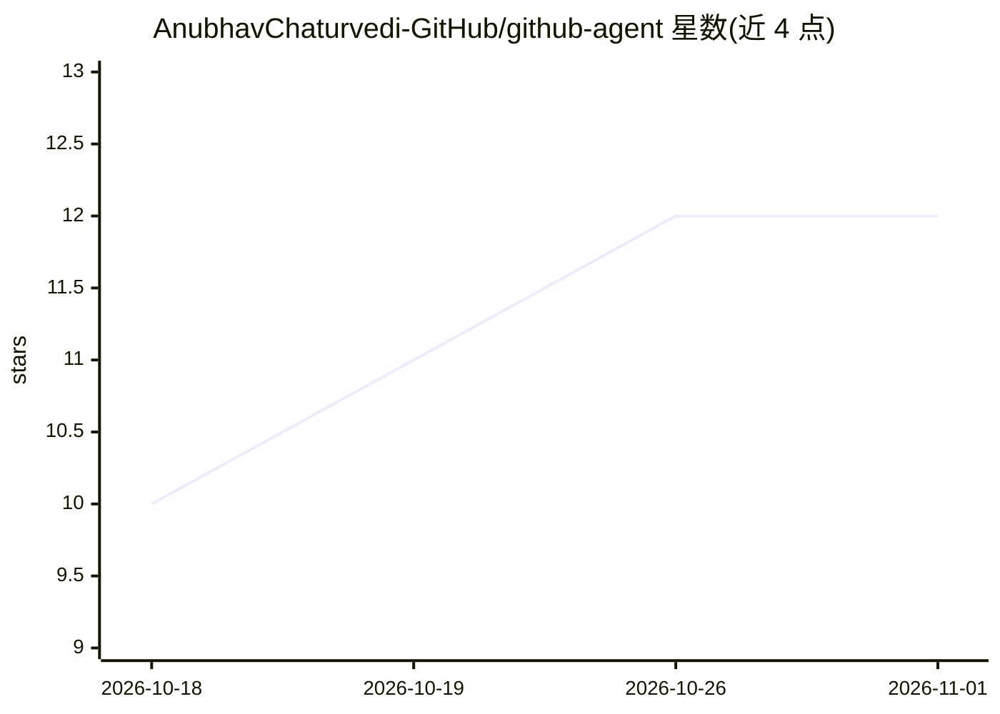

# AnubhavChaturvedi-GitHub/github-agent

⭐ 12 · JavaScript · NOASSERTION · 推送 2026-08-12 · [GitHub](https://github.com/AnubhavChaturvedi-GitHub/github-agent) · 个人维护

**本地浏览器端 AI 助手：用自然语言对话浏览与查询 GitHub 仓库**

基于 Vite 与原生 JavaScript 构建的单页应用，通过用户的 GitHub 个人访问令牌连接 GitHub REST API，提供仓库对话问答、代码搜索、Issue 与 PR 上下文引用等功能，回答基于真实文件内容与提交历史。应用完全在浏览器中运行，无后端服务器，令牌不出本机。运行需 Node.js 18+ 与带 repo 权限的 GitHub 令牌，通过 git clone 与 npm 命令本地启动，也可构建为静态包自行托管。

## 筛选速览

| 维度 | 判定 | 备注 |
|---|---|---|
| AI 角色 | `ai-native` | 本体是模型或模型工具 |
| 许可风险 | `permissive` | NOASSERTION |
| 部署形态 | `library` | 以包/库形式分发 |
| 模型依赖 | — | README 未给出锁定关系 |
| 硬件要求 | — | 无带数字的原话,不猜 |
| 安装摩擦 | `low` | 无编译、无系统依赖或容器化 |
| 成熟度 | — | 结构信号不足 |

## 能力要点

- 纯浏览器运行，GitHub 令牌不离开本机，无后端服务器
- 仓库对话问答基于真实文件内容、Issue 与提交历史
- 跨仓库代码搜索：查找函数、模式与文件
- 支持构建静态产物 dist/ 任意位置托管

## 适用场景

- 用自然语言向 AI 询问某个仓库的实现细节
- 在本地检索函数、代码模式与文件位置
- 结合 Issue 与 PR 讨论理解代码背景

## 场景标签

`聊天机器人` · 领域:对话与助手

## 证据(README 行号)

> L3: > Chat with your GitHub repositories from a local web app. Browse code, search repos, review issues and run reposito
> L14: GitHub Agent is a single-page app that connects to the GitHub API with your personal access token and puts an AI as

## 星数曲线

2026-10-18 10 → 2026-11-01 12（+2）

---
*卡片 v1 · prompt 1.4 · 生成 2026-11-01 · 置信度 high · 依据 README sha `3472f9cab602` · [字段定义](../../DATASET.md)*
