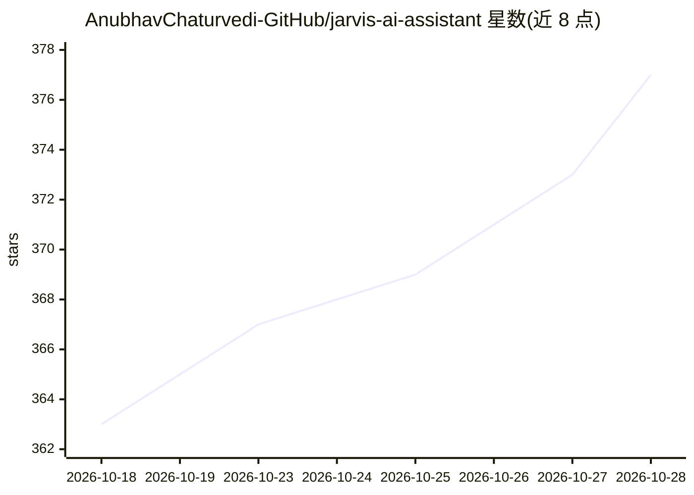

# AnubhavChaturvedi-GitHub/jarvis-ai-assistant

⭐ 381 · Python · GPL-3.0 · 推送 2026-08-12 · [GitHub](https://github.com/AnubhavChaturvedi-GitHub/jarvis-ai-assistant) · [官网](https://www.youtube.com/@NetHyTech) · 个人维护

**语音控制的 Python 桌面 AI 助手：听说、联网、控电脑**

用 Python 编写的语音激活桌面助手，灵感来自钢铁侠的 J.A.R.V.I.S。项目按可替换子系统组织：自研语音识别引擎（NetHyTechSTT，无需付费 API）、文本转语音、语言模型推理与对话记忆（co_brain）、实时联网搜索、文生图、摄像头视觉理解、桌面/应用自动化、WhatsApp 自动发消息、天气查询与闹钟提醒。通过唤醒词加自然语言指令交互，可终端运行或使用 Tkinter 窗口界面。需 Python 3.10+、麦克风扬声器与 Chrome 浏览器。

## 筛选速览

| 维度 | 判定 | 备注 |
|---|---|---|
| AI 角色 | `ai-native` | 本体是模型或模型工具 |
| 许可风险 | `viral` | GPL-3.0 |
| 部署形态 | `library` | 以包/库形式分发 |
| 模型依赖 | — | README 未给出锁定关系 |
| 硬件要求 | — | 无带数字的原话,不猜 |
| 安装摩擦 | `low` | 无编译、无系统依赖或容器化 |
| 成熟度 | — | 结构信号不足 |

## 能力要点

- 自研 STT 引擎 NetHyTechSTT，无需付费 API
- 语音到图像生成与摄像头视觉理解
- 桌面控制、应用启动与 WhatsApp 自动发消息
- 模块化子系统结构，可只用所需部分

## 适用场景

- 用语音指令操作电脑、打开应用和执行系统任务
- 免手操作发送 WhatsApp 消息与设置提醒
- 语音提问并获取联网实时信息（天气、新闻、搜索）

## 场景标签

`AI 助手` `语音 Agent` `GUI 自动化` · 领域:效率与自动化

## 证据(README 行号)

> L14: J.A.R.V.I.S (Just A Rather Very Intelligent System) is a Python voice assistant inspired by Iron Man. You speak, it
> L22: |`Brain` / `co_brain.py`|Language model reasoning and conversation memory|

## 星数曲线

2026-10-18 363 → 2026-10-28 377（+14）

---
*卡片 v1 · prompt 1.4 · 生成 2026-10-21 · 置信度 mid · 依据 README sha `30aab08a1e3a` · [字段定义](../../DATASET.md)*
