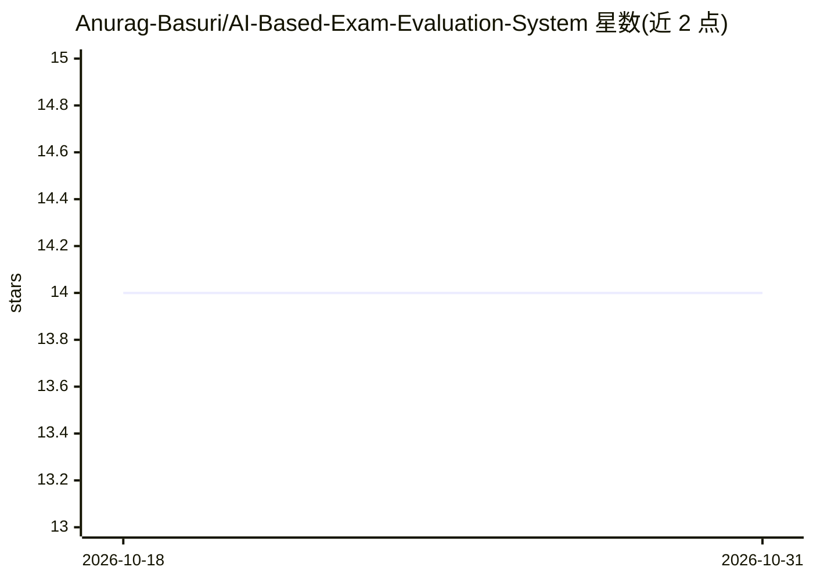

# Anurag-Basuri/AI-Based-Exam-Evaluation-System

⭐ 14 · JavaScript · MIT · 推送 2026-07-19 · [GitHub](https://github.com/Anurag-Basuri/AI-Based-Exam-Evaluation-System) · [官网](https://ai-based-exam-evaluation-system.vercel.app) · 个人维护

**面向师生的 AI 考试平台：从课件生成试卷并自动批改主观题**

微服务架构的全栈考试管理平台：Node.js(Express) 作为 API 网关，Python/FastAPI 微服务承载 AI 任务。教师上传 PDF/DOCX 课件后，通过 LangGraph 有状态 Agent 对话式生成并迭代试卷草稿；学生提交答案后，经 BullMQ 队列异步运行严格 RAG 评分——LLM 仅依据检索到的参考资料文本打分，不支持的内容扣分。LLM 接入采用 Groq→Cerebras→OpenRouter→HuggingFace 的自动降级链。含教室管理、考试生命周期状态机、切屏监控、JWT 轮换认证与实时 WebSocket 更新。本地运行需分别安装前后端与 Agent 微服务并配置多个 .env 变量及至少一个 LLM API key。

## 筛选速览

| 维度 | 判定 | 备注 |
|---|---|---|
| AI 角色 | `ai-native` | 本体是模型或模型工具 |
| 许可风险 | `permissive` | MIT |
| 部署形态 | `library` | 以包/库形式分发 |
| 模型依赖 | locked-api |  |
| 硬件要求 | — | 无带数字的原话,不猜 |
| 安装摩擦 | `low` | 无编译、无系统依赖或容器化 |
| 成熟度 | — | 结构信号不足 |

## 能力要点

- LangGraph 有状态 Agent 对话式生成试卷，简单修改命令走零 token 的 RegEx 解析
- 严格 RAG 评分：LLM 限定只用教师参考资料文本，BullMQ 异步处理提交
- Groq/Cerebras/OpenRouter/HuggingFace 四级 LLM 提供商自动降级链
- 微服务架构：Node.js 网关 + FastAPI AI 服务 + Socket.IO 实时更新

## 适用场景

- 教师上传课件后用对话方式生成并调整试卷
- 对学生主观题答案做基于参考资料的 AI 批改
- 按教室组织考试、监控切屏行为并查看成绩分析图表

## 场景标签

 · 领域:教育/考试管理

## 证据(README 行号)

> L26: * **Conversational Exam Generation:** Upload a PDF or DOCX file to your classroom. Chat with our AI agent to instan
> L27: * **Honest AI Grading:** When students submit long-form answers, the AI grades them strictly based on the reference
> L98: ### 3. Strict-RAG Evaluation

## 星数曲线

2026-10-18 14 → 2026-10-31 14（+0）

---
*卡片 v1 · prompt 1.4 · 生成 2026-10-31 · 置信度 high · 依据 README sha `a1eecfd7deca` · [字段定义](../../DATASET.md)*
