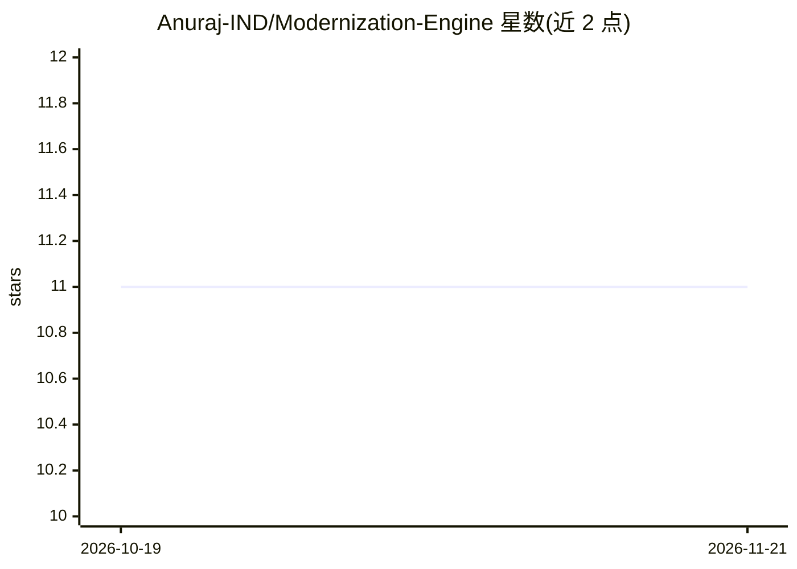

# Anuraj-IND/Modernization-Engine

⭐ 11 · Python · 推送 2026-05-02 · [GitHub](https://github.com/Anuraj-IND/Modernization-Engine) · 个人维护

**面向开发者的 Java 遗留代码现代化转换引擎，升级到 Java 21 或转 Python**

以 Java 仓库为输入、输出完整转换后代码库的三阶段流水线：Phase 1 用 tree-sitter 做确定性静态分析，生成 IR 注册表、依赖图与循环依赖簇 JSON；Phase 2 基于 Ollama nomic-embed-text 构建离线架构检索；Phase 3 提供三条转换路径——AST 规则补丁（无 LLM）、DAG 拓扑序的 Java 升级、骨架优先的 Java 转 Python，附 10 类错误的确定性后处理器与 ast.parse 校验。全部推理在本地 Ollama 上运行，使用 qwen2.5-coder:14b 模型，数据不出机器。带 FastAPI 全栈 Web UI（上传/日志/对照浏览/问答），支持任务中断续跑与失败重试。

## 筛选速览

| 维度 | 判定 | 备注 |
|---|---|---|
| AI 角色 | `ai-enhanced` | 去掉 AI 部分产品仍成立 |
| 许可风险 | `none` | — |
| 部署形态 | `library` | 以包/库形式分发 |
| 模型依赖 | local-ok | 支持本地模型 |
| 硬件要求 | — | 无带数字的原话,不猜 |
| 安装摩擦 | `medium` | 含编译或系统依赖之一 |
| 成熟度 | — | 结构信号不足 |

## 能力要点

- 三阶段流水线：静态分析 IR → 离线架构 RAG → 分路径转换
- Java→Python 的 10 类确定性后处理修复与骨架锁定，失败时输出带 TODO 的有效骨架
- 依赖 DAG 拓扑序翻译，已译文件存语义 stub 注入后续提示
- 本地 Ollama 推理（qwen2.5-coder:14b / nomic-embed-text），支持断点续跑

## 适用场景

- 把 10–20 年的企业级 Java 代码库升级到 Java 21/22/25
- 将 Java 应用整体翻译为 Python 3 代码库
- 在本地离线环境下处理不希望出网的代码资产
- 对 Java 8 代码做无 LLM 参与的确定性 API 升级补丁

## 场景标签

`代码生成` · 领域:编码与开发

## 证据(README 行号)

> L3: > AI-powered pipeline that modernizes Java codebases — either to **Java 21** or **Python 3** — using context optimiz
> L11: - **Java 8 → Java 8/11/17** — deterministic AST patch rules with zero LLM involvement
> L13: The entire pipeline runs **locally on Ollama** using `qwen2.5-coder:14b-instruct-q4_K_M`. No cloud API, no data lea

## 星数曲线

2026-10-19 11 → 2026-11-21 11（+0）

---
*卡片 v1 · prompt 1.4 · 生成 2026-11-19 · 置信度 high · 依据 README sha `2628fc387d9b` · [字段定义](../../DATASET.md)*
