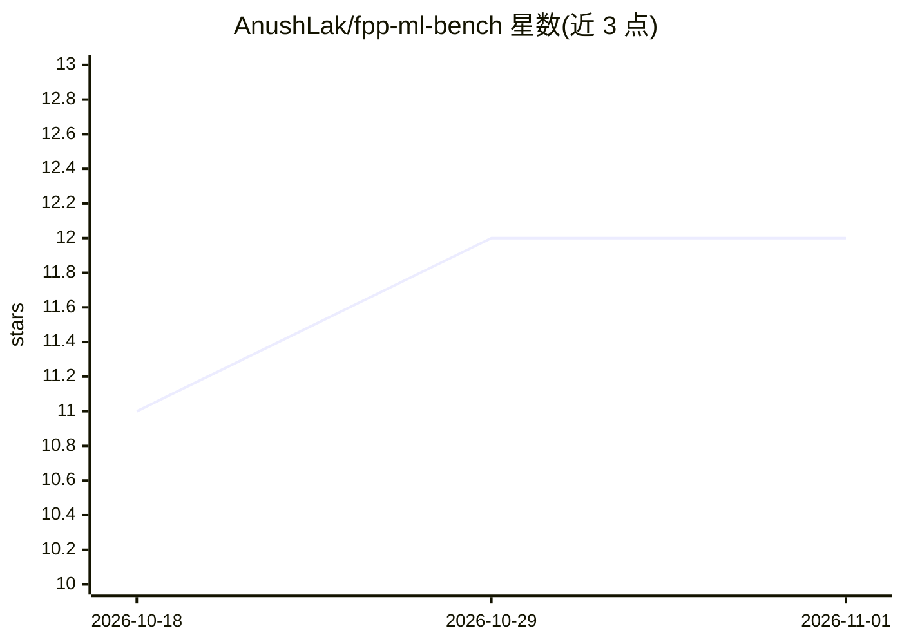

# AnushLak/fpp-ml-bench

⭐ 12 · Python · MIT · 推送 2026-02-03 · [GitHub](https://github.com/AnushLak/fpp-ml-bench) · [官网](https://arxiv.org/abs/2601.08900) · 组织维护

**条纹投影轮廓术单帧深度估计的深度学习基准评测框架**

面向单帧条纹投影轮廓术（FPP）深度估计的标准化基准评测框架，实现 UNet、Hformer、ResUNet、pix2pixHD 四种架构，提供统一训练管线、6 种损失函数（含 masked/hybrid 变体）、3 种数据归一化方案与统一命令行接口。基准数据由 VIRTUS-FPP 光真实感虚拟传感器管线生成，公开数据集发布于 HuggingFace。要求 Python 3.8+/PyTorch 1.10+，GPU 训练需 CUDA 11.0+；论文被 SPIE Photonics West 2026 接收。

## 筛选速览

| 维度 | 判定 | 备注 |
|---|---|---|
| AI 角色 | `ai-ecosystem` | LLM/agent 周边工具 |
| 许可风险 | `permissive` | MIT |
| 部署形态 | `None` |  |
| 模型依赖 | — | README 未给出锁定关系 |
| 硬件要求 | — | 无带数字的原话,不猜 |
| 安装摩擦 | `medium` | 含编译或系统依赖之一 |
| 成熟度 | — | 结构信号不足 |

## 能力要点

- 统一训练管线覆盖 4 种架构（参数量 5M-188M）
- 6 种损失函数与 3 种归一化方案的组合评测
- 统一命令行接口，支持断点续训与训练日志记录
- 配套 HuggingFace 公开数据集（VIRTUS-FPP 合成）

## 适用场景

- 在统一条件下对比不同深度估计架构的 FPP 重建表现
- 复现论文基准结果并续训/调参
- 为条纹投影深度估计任务选择损失函数与归一化方案

## 场景标签

`模型评测` · 领域:评测与运维

## 证据(README 行号)

> L15: This repository provides a standardized benchmarking framework for evaluating deep learning models on single-shot f
> L17: The framework implements four state-of-the-art architectures with unified training pipelines, loss functions, and d

## 星数曲线

2026-10-18 11 → 2026-11-01 12（+1）

---
*卡片 v1 · prompt 1.4 · 生成 2026-11-01 · 置信度 high · 依据 README sha `7dadbf07aa80` · [字段定义](../../DATASET.md)*
