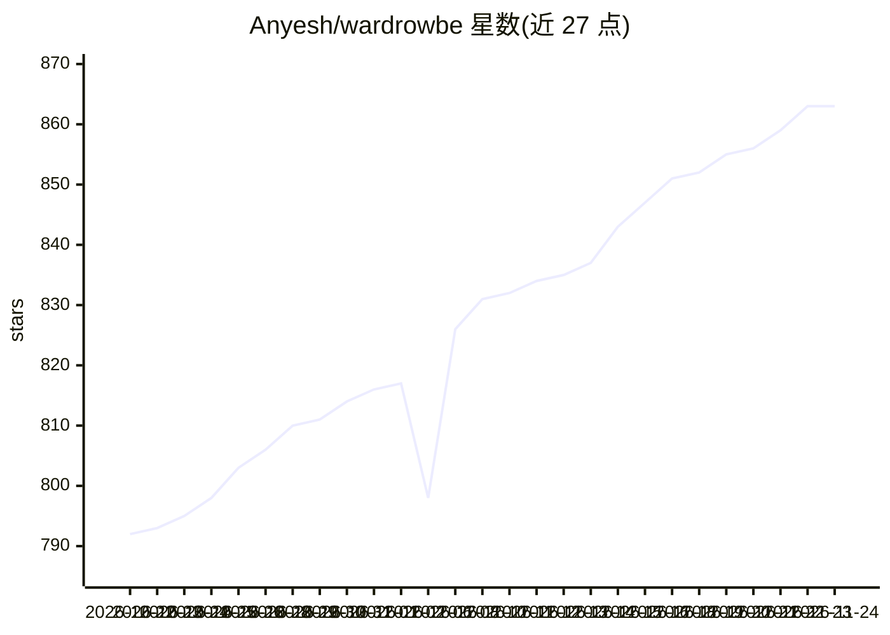

# Anyesh/wardrowbe

⭐ 863 · Python · MIT · 推送 2026-11-21 · [GitHub](https://github.com/Anyesh/wardrowbe) · [官网](https://wardrowbe.com) · 个人维护

**自托管衣橱管理应用：AI 自动标注衣物并推荐穿搭**

Next.js + FastAPI 构建的自托管衣橱管理应用：上传衣物照片后由视觉模型提取颜色、款式等信息自动打标，并根据天气、场合与个人偏好生成每日穿搭建议。支持家庭成员多衣橱、穿着历史与评分、洗衣追踪、穿着统计；通过 ntfy/Mattermost/email 发送定时通知；支持 8 种语言、OIDC 登录。AI 后端兼容任意 OpenAI-compatible API，也可完全关闭内部 AI 改用外部 agent。提供 Docker Compose 生产部署与 Kubernetes 清单，并有 iOS/Android 客户端上架应用商店。

## 筛选速览

| 维度 | 判定 | 备注 |
|---|---|---|
| AI 角色 | `ai-enhanced` | 去掉 AI 部分产品仍成立 |
| 许可风险 | `permissive` | MIT |
| 部署形态 | `self-host` | docker 或自建部署 |
| 模型依赖 | local-ok | 支持本地模型 |
| 硬件要求 | — | 无带数字的原话,不猜 |
| 安装摩擦 | `low` | 无编译、无系统依赖或容器化 |
| 成熟度 | — | 结构信号不足 |

## 能力要点

- 照片上传后 AI 自动提取衣物颜色、图案、款式
- 按天气与场合生成穿搭建议并推送每日通知（ntfy/Mattermost/email）
- 支持 OpenAI、Ollama、LocalAI 等任意 OpenAI-compatible API
- 可整体或按能力关闭内部 AI，外部 agent 可接管打标与建议

## 适用场景

- 自托管管理全家人的衣物照片与穿搭记录
- 每天根据天气自动收到穿搭建议推送
- 离线/本地运行 AI 完成衣物打标与推荐

## 场景标签

 · 领域:生活/个人管理工具

## 证据(README 行号)

> L33: Self-hosted wardrobe management with AI-powered outfit recommendations. Take photos of your clothes, let AI tag the
> L44: - **Works with any AI** - OpenAI, Ollama, LocalAI, or any OpenAI-compatible API

## 星数曲线

2026-10-22 792 → 2026-11-24 863（+71）

---
*卡片 v1 · prompt 1.4 · 生成 2026-11-24 · 置信度 high · 依据 README sha `18f4e9802dad` · [字段定义](../../DATASET.md)*
