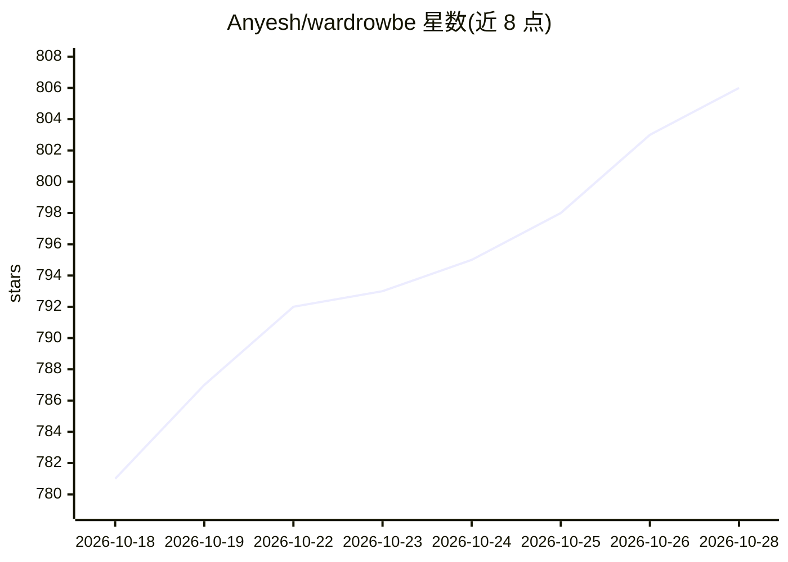

# Anyesh/wardrowbe

⭐ 806 · Python · MIT · 推送 2026-10-23 · [GitHub](https://github.com/Anyesh/wardrowbe) · [官网](https://wardrowbe.com) · 个人维护 · 中文 README

**自托管 AI 衣柜管理应用：拍照建档并推荐每日穿搭**

面向个人与家庭的自托管衣柜管理应用：上传衣物照片后由视觉模型自动提取颜色、款式等标签，文本模型按天气、场合与偏好生成每日穿搭建议，并支持穿着记录、洗涤追踪、配色分析与经 ntfy/Mattermost/邮件推送的定时通知。技术栈为 Next.js 前端加 FastAPI 后端，依赖 PostgreSQL 与 Redis，通过 Docker Compose 或 Kubernetes 部署，兼容任意 OpenAI 兼容 API（含本地 Ollama/LocalAI），也支持在关闭内部 AI 后由外部 agent 提供标签与建议。提供 App Store 客户端，Google Play 标注即将上线。

## 筛选速览

| 维度 | 判定 | 备注 |
|---|---|---|
| AI 角色 | `ai-enhanced` | 去掉 AI 部分产品仍成立 |
| 许可风险 | `permissive` | MIT |
| 部署形态 | `self-host` | docker 或自建部署 |
| 模型依赖 | local-ok | 支持本地模型 |
| 硬件要求 | — | 无带数字的原话,不猜 |
| 安装摩擦 | `low` | 无编译、无系统依赖或容器化 |
| 成熟度 | — | 结构信号不足 |

## 能力要点

- 视觉模型自动从衣物照片提取颜色、图案与款式标签
- 按天气、场合与偏好生成穿搭建议并定时推送（ntfy/Mattermost/邮件）
- 兼容任意 OpenAI 兼容 API，支持 Ollama 本地离线运行
- 多成员家庭衣柜、穿着历史与分析、8 种界面语言
- 可设置 AI_INTERNAL_ENABLED=false 关闭内部 AI，改由外部 agent 提供能力

## 适用场景

- 把自己的衣物拍照建档并获得每日穿搭建议
- 为家庭成员分别管理衣柜并跟踪穿着与洗涤
- 在自有硬件上自托管，数据不出本地

## 场景标签

 · 领域:生活/自托管应用

## 证据(README 行号)

> L31: Self-hosted wardrobe management with AI-powered outfit recommendations. Take photos of your clothes, let AI tag the
> L42: - **Works with any AI** - OpenAI, Ollama, LocalAI, or any OpenAI-compatible API

## 星数曲线

2026-10-18 781 → 2026-10-28 806（+25）

---
*卡片 v1 · prompt 1.4 · 生成 2026-10-21 · 置信度 high · 依据 README sha `18df47008b0e` · [字段定义](../../DATASET.md)*
