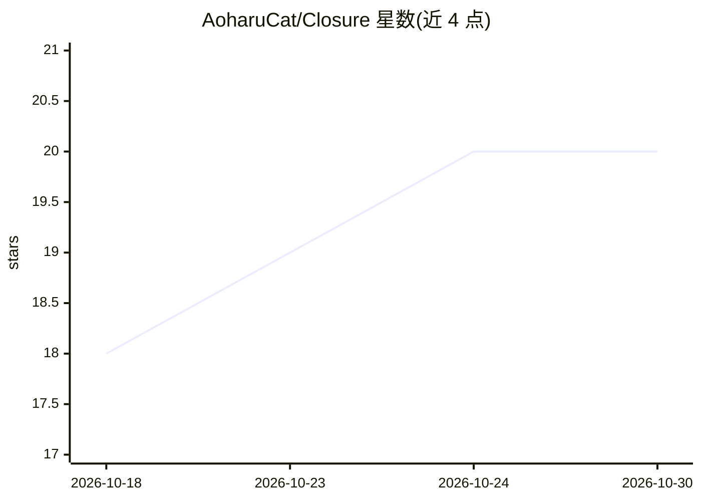

# AoharuCat/Closure

⭐ 20 · TypeScript · AGPL-3.0 · 推送 2026-10-11 · [GitHub](https://github.com/AoharuCat/Closure) · 个人维护 · 中文 README

**本地优先的 AI 小说创作 IDE：面向网文与长篇作者**

Closure 是 OrisonSpace（Apache-2.0）的 fork，以 AGPL-3.0-or-later 发布的桌面端（Electron）AI 小说创作 IDE，面向网文与长篇小说作者。把大纲、章节、人物与世界观资产卡整合到一个工作区，叠加叙事状态机（信息差、情绪、欲望、叙事依赖图）等模块；模型接任意 OpenAI/Anthropic 兼容端点，或经 Antigravity CLI 直连 Gemini。作品以本地文件保存，无需账号。项目自述处于 Alpha 早期开发阶段，Windows 优先，macOS/Linux 尚未充分实测，macOS 包未签名。

## 筛选速览

| 维度 | 判定 | 备注 |
|---|---|---|
| AI 角色 | `ai-native` | 本体是模型或模型工具 |
| 许可风险 | `viral` | AGPL-3.0 |
| 部署形态 | `desktop` | 安装包/桌面程序 |
| 模型依赖 | — | README 未给出锁定关系 |
| 硬件要求 | — | 无带数字的原话,不猜 |
| 安装摩擦 | `low` | 无编译、无系统依赖或容器化 |
| 成熟度 | `idea` | |

## 能力要点

- 写章链流程：导演核对设定、写手两阶段成稿、六组维度审核、词级修订对比
- 信息差操控与世界事件系统：分层记录事实真相与读者所知，伏笔库存可视
- 双层审核漏斗：先跑免费纯代码规则，有问题才交模型细审且意见须附原文引证
- 任务型模型分档路由、用量面板（token/费用/月度预算）与熔断回退链

## 适用场景

- 长篇网文创作中沉淀大纲、人物设定与世界观资产并保持百万字一致性
- 让 AI 执行续写、润色、审核，同时自己保留每一步的拍板与回退权
- 导入他人作品拆解风格与设定，蒸馏为风格卡和手艺卡供写作参考

## 场景标签

`AI 写作` · 领域:内容生成

## 证据(README 行号)

> L21: **Closure** 是一款开源、本地优先的 AI 小说创作 IDE，面向网文与长篇小说作者，把大纲、章节、人物与世界观资产卡整合到一个工作区。它以「用户主导创意、AI 执笔与自查」为原则，提供 AI 生成、续写、润色、审阅与可
> L64: - **写章链** — 写一章的完整流程：对话下意图、导演核对设定、装配上下文、写手成稿、检查点停下等你过目、审核修订、落章后回来汇报。每一步都暂停等人，方向盘始终在你手里；写作页以一条全程时间线把思考、调查、产出、正文流逐段亮出
> L223: 一款开源、本地优先的 AI 小说创作 IDE，把大纲、章节、人物与世界观资产卡整合到一个工作区，提供 AI 生成、续写、润色、审阅与可控修改。

## 星数曲线

2026-10-18 18 → 2026-10-30 20（+2）

---
*卡片 v1 · prompt 1.4 · 生成 2026-10-28 · 置信度 high · 依据 README sha `9639599f91c4` · [字段定义](../../DATASET.md)*
