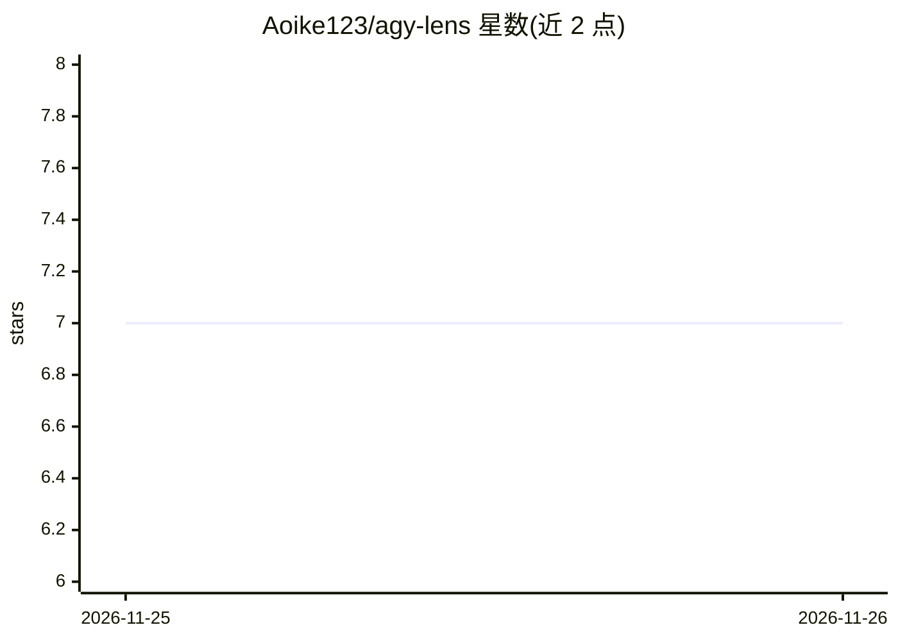

# Aoike123/agy-lens

⭐ 7 · JavaScript · MIT · 推送 2026-11-24 · [GitHub](https://github.com/Aoike123/agy-lens) · [官网](https://github.com/Aoike123/agy-lens#readme) · 个人维护

**Antigravity 2.0 本地配额与上下文监控面板/CLI：只读查看 token 用量**

面向 Antigravity 2.0 用户的本地监控插件与终端 CLI：读取应用本地的对话数据库和语言服务器，提供按类别的精确上下文窗口占用、流式 tok/s、5 小时与每周配额倒计时、隐含每周配额美元价值与缩水追踪、子代理树成本汇总，以及脱敏分享卡片。零依赖、只读、默认不联网，刷新不消耗 token；需 Node.js 24 环境（随 Antigravity 桌面端附带）。

## 筛选速览

| 维度 | 判定 | 备注 |
|---|---|---|
| AI 角色 | `ai-enhanced` | 去掉 AI 部分产品仍成立 |
| 许可风险 | `permissive` | MIT |
| 部署形态 | `desktop` | 安装包/桌面程序 |
| 模型依赖 | — | README 未给出锁定关系 |
| 硬件要求 | — | 无带数字的原话,不猜 |
| 安装摩擦 | `low` | 无编译、无系统依赖或容器化 |
| 成熟度 | — | 结构信号不足 |

## 能力要点

- 按类别精确统计上下文窗口，与 /context 对齐
- 官方 5 小时与每周配额读数及重置倒计时
- 隐含每周配额美元价值与逐周缩水追踪
- 脱敏分享卡片导出为 PNG/SVG，不含标题与路径

## 适用场景

- 查看当前对话的上下文占用，避免被静默截断历史
- 追踪每周配额消耗进度和隐含美元价值
- 按项目/会话分析 token 去向与子代理开销

## 场景标签

 · 领域:开发工具/用量监控

## 证据(README 行号)

> L5: **The all-in-one local cockpit & CLI for Antigravity 2.0.**
> L18: Never get blindsided by a 5-hour wall, silent context trimming, or quiet weekly quota shrinkage again. Agy Lens rea

## 星数曲线

2026-11-25 7 → 2026-11-26 7（+0）

---
*卡片 v1 · prompt 1.4 · 生成 2026-11-24 · 置信度 high · 依据 README sha `6c2423e72ed9` · [字段定义](../../DATASET.md)*
