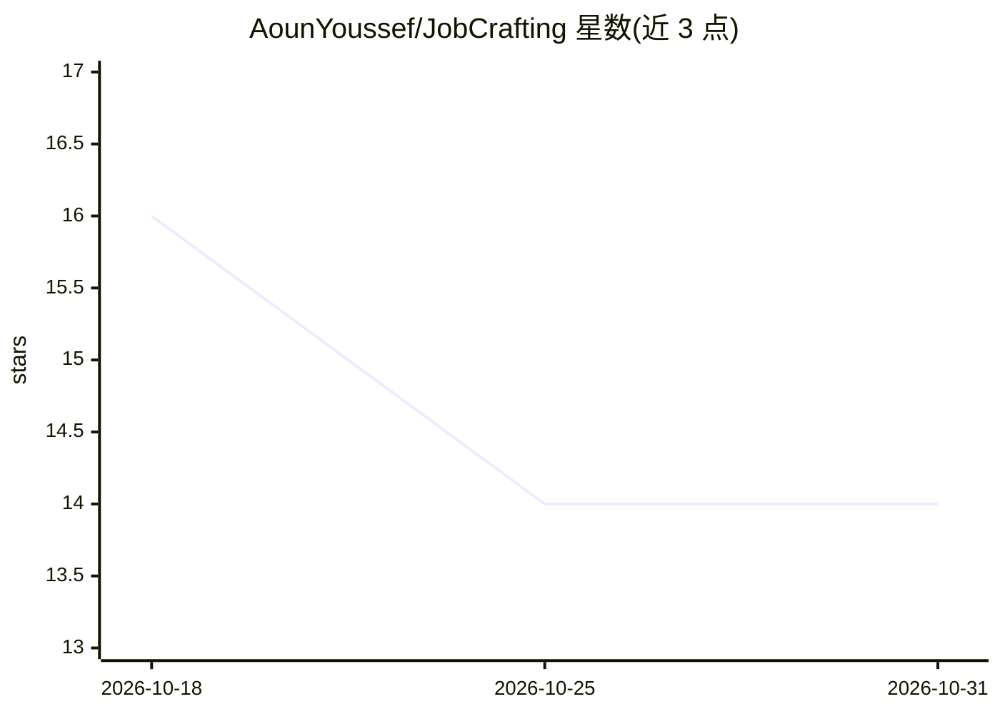

# AounYoussef/JobCrafting

⭐ 14 · TypeScript · MIT · 推送 2026-07-02 · [GitHub](https://github.com/AounYoussef/JobCrafting) · [官网](https://jobcrafting.vercel.app) · 个人维护

**AI 职业匹配平台：帮用户找到契合技能与价值观的工作**

面向求职者与职场人群的 Web 应用，提供智能职位匹配、AI 职业教练、AI 简历优化三大功能，结合组织心理学方法分析技能、经验、兴趣、职业抱负与个人价值观。技术栈为 React + Vite 前端、Node.js 后端、Google Gemini 提供 AI 能力、Firebase 认证。运行需 Node.js v18+、Gemini 与 Firebase API key，通过 git clone 源码与 npm 安装启动开发服务器，MIT 许可。

## 筛选速览

| 维度 | 判定 | 备注 |
|---|---|---|
| AI 角色 | `ai-native` | 本体是模型或模型工具 |
| 许可风险 | `permissive` | MIT |
| 部署形态 | `library` | 以包/库形式分发 |
| 模型依赖 | — | README 未给出锁定关系 |
| 硬件要求 | — | 无带数字的原话,不猜 |
| 安装摩擦 | `low` | 无编译、无系统依赖或容器化 |
| 成熟度 | — | 结构信号不足 |

## 能力要点

- AI 职位匹配：按技能、经验、兴趣、价值观与职业抱负对齐
- AI 职业教练：个性化成长建议与长期职业规划
- AI 简历分析与优化反馈

## 适用场景

- 找工作时获得与自身技能和价值观匹配的职位推荐
- 让 AI 帮我改进简历提高可见性
- 获得长期的职业发展建议

## 场景标签

`AI 助手` `AI 写作` · 领域:对话与助手

## 证据(README 行号)

> L21: Uses AI to connect users with opportunities that align with their:
> L31: Provides personalized guidance to help users:
> L54: * **AI:** Google Gemini

## 星数曲线

2026-10-18 16 → 2026-10-31 14（-2）

---
*卡片 v1 · prompt 1.4 · 生成 2026-10-31 · 置信度 high · 依据 README sha `fc0b2d830508` · [字段定义](../../DATASET.md)*
