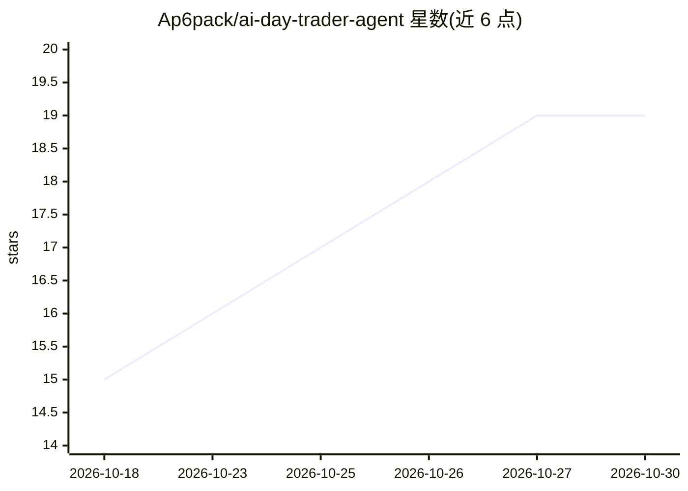

# Ap6pack/ai-day-trader-agent

⭐ 19 · Python · MIT · 推送 2026-10-13 · [GitHub](https://github.com/Ap6pack/ai-day-trader-agent) · 个人维护

**构建于 Claude Code 的日内交易助手：分析行情与新闻并下单**

基于 Claude Code 的日内交易项目：Claude 通过 Robinhood MCP 工具执行分析与下单，仓库补充订单守卫钩子（硬限额校验）、TypeSafe Jev 模型新闻判分、交易日志与复盘、日内交易技能包、独立新闻交易机器人（Alpaca 新闻流驱动，默认 paper 账户）以及实时交易台。订单守卫仅在 Claude Code 内生效，实盘需双重配置并受单笔/每日限额约束。Python 项目，git clone 后 venv 安装 requirements 运行。

## 筛选速览

| 维度 | 判定 | 备注 |
|---|---|---|
| AI 角色 | `ai-native` | 本体是模型或模型工具 |
| 许可风险 | `permissive` | MIT |
| 部署形态 | `library` | 以包/库形式分发 |
| 模型依赖 | locked-api |  |
| 硬件要求 | — | 无带数字的原话,不猜 |
| 安装摩擦 | `low` | 无编译、无系统依赖或容器化 |
| 成熟度 | — | 结构信号不足 |

## 能力要点

- Claude Code 钩子实现的订单守卫：硬限额校验，review 模式默认拦截全部订单
- Jev 模型对每条新闻判分（相关性/方向/重要性/事件类型），带时间衰减聚合
- 新闻机器人流式交易 Alpaca 新闻，默认 paper 账户，实盘需显式双重 opt-in
- 交易日志记录每笔决策并按当日收盘评分，autopilot 生成复盘报告

## 适用场景

- 用 Claude 分析自选股的日内交易机会并给出仓位建议
- 让新闻机器人按 Jev 判分规则在 paper 账户自动下括号单
- 先在 review-only 模式评分策略，再决定是否实盘

## 场景标签

`金融量化` · 领域:学习与行业

## 证据(README 行号)

> L3: An intraday trading assistant built on Claude Code. Claude does the analysis and
> L17: - **A news bot** (`trader.newsbot`) that trades Alpaca's news stream on its own: Jev

## 星数曲线

2026-10-18 15 → 2026-10-30 19（+4）

---
*卡片 v1 · prompt 1.4 · 生成 2026-10-29 · 置信度 mid · 依据 README sha `62a6d5697988` · [字段定义](../../DATASET.md)*
