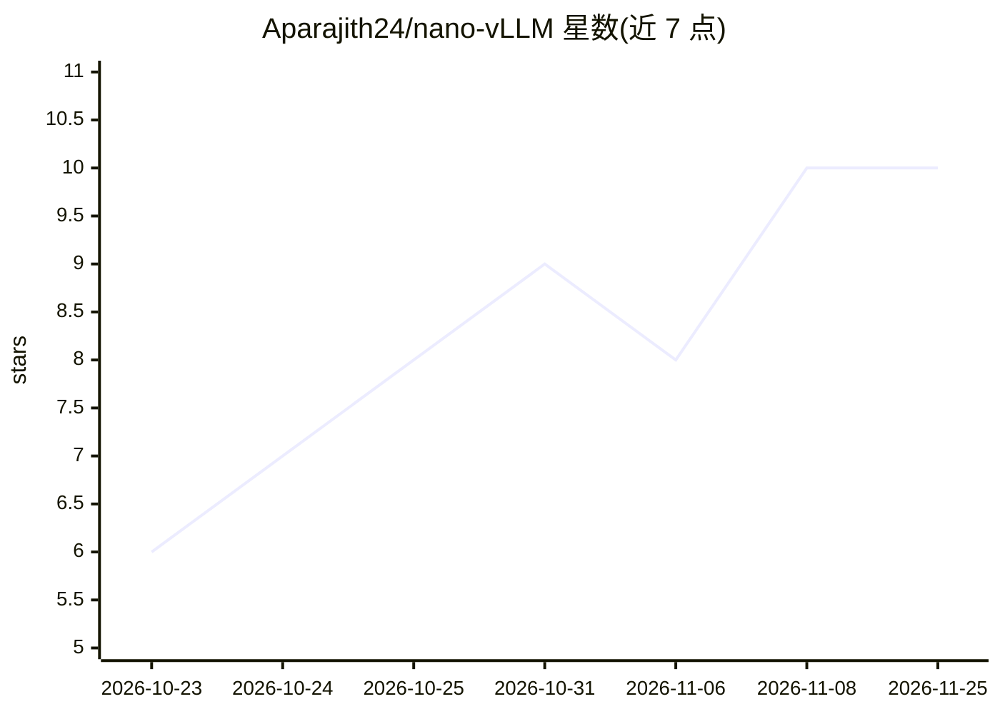

# Aparajith24/nano-vLLM

⭐ 10 · Python · 推送 2026-11-11 · [GitHub](https://github.com/Aparajith24/nano-vLLM) · 个人维护

**供学习者的 PyTorch 迷你版 vLLM 推理引擎**

用 PyTorch 从零实现的 LLM 推理引擎，目的是通过动手构建理解 vLLM 这类引擎的核心机制。实现包括 OpenAI 兼容的 /v1/completions 流式端点、continuous batching、分页 KV cache、prefix caching 与 chunked/batched prefill，每项改动都与保留的 baseline server 对比测量。README 给出 Apple M4 (MPS) 上的吞吐、TTFT、ITL 数据、逐模块耗时分析，以及与 Hugging Face 输出对齐的正确性测试。通过 python3 直接运行 server.py 使用。

## 筛选速览

| 维度 | 判定 | 备注 |
|---|---|---|
| AI 角色 | `ai-ecosystem` | LLM/agent 周边工具 |
| 许可风险 | `none` | — |
| 部署形态 | `None` |  |
| 模型依赖 | — | README 未给出锁定关系 |
| 硬件要求 | — | 无带数字的原话,不猜 |
| 安装摩擦 | `medium` | 含编译或系统依赖之一 |
| 成熟度 | — | 结构信号不足 |

## 能力要点

- OpenAI 兼容流式补全端点（SSE）
- 分页 KV cache、prefix caching、chunked prefill、continuous batching
- 每项优化带与 baseline 的对比测量数据
- 多个测试文件逐项对照 Hugging Face 验证输出一致性

## 适用场景

- 阅读源码学习 vLLM 类推理引擎的核心机制
- 本地复现并测量 continuous batching 与 KV cache 的收益
- 作为推理系统课程的实验代码

## 场景标签

`推理引擎` `教程课程` · 领域:学习与行业

## 证据(README 行号)

> L3: A small LLM inference engine, built to understand how engines like vLLM work by
> L6: - an **OpenAI-compatible** `POST /v1/completions` endpoint that streams tokens
> L84: python3 server.py

## 星数曲线

2026-10-23 6 → 2026-11-25 10（+4）

---
*卡片 v1 · prompt 1.4 · 生成 2026-11-20 · 置信度 high · 依据 README sha `d336114fe89f` · [字段定义](../../DATASET.md)*
